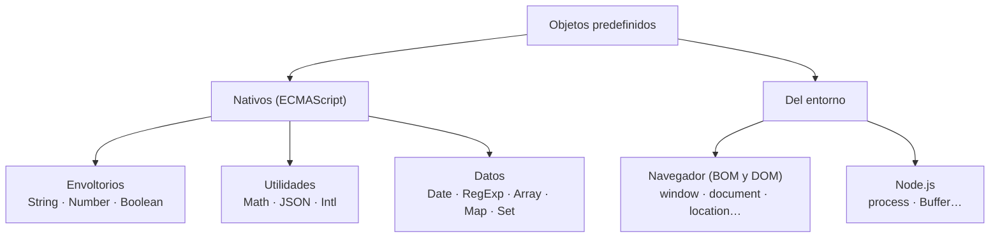

# 1. Objetos nativos del lenguaje

[⬅️ Volver a la unidad](./README.md)

## Índice

- [1.1. Qué es un objeto predefinido](#11-qué-es-un-objeto-predefinido)
  - [1.1.1. Objetos nativos y objetos del entorno](#111-objetos-nativos-y-objetos-del-entorno)
  - [1.1.2. Cómo se usan: constructores, métodos estáticos y de instancia](#112-cómo-se-usan-constructores-métodos-estáticos-y-de-instancia)
- [1.2. Objetos envoltorio: `String`, `Number` y `Boolean`](#12-objetos-envoltorio-string-number-y-boolean)
- [1.3. `String`: trabajar con textos](#13-string-trabajar-con-textos)
- [1.4. `Number`: trabajar con números](#14-number-trabajar-con-números)
- [1.5. `Math`: cálculos](#15-math-cálculos)
- [1.6. `Date`: fechas y horas](#16-date-fechas-y-horas)
  - [1.6.1. Crear fechas](#161-crear-fechas)
  - [1.6.2. Leer y modificar una fecha](#162-leer-y-modificar-una-fecha)
  - [1.6.3. Calcular con fechas](#163-calcular-con-fechas)
  - [1.6.4. Temporal: el futuro de las fechas](#164-temporal-el-futuro-de-las-fechas)
- [1.7. `JSON`: datos como texto](#17-json-datos-como-texto)
- [1.8. `Intl`: textos para cada idioma y país](#18-intl-textos-para-cada-idioma-y-país)
- [1.9. `RegExp`: una primera mirada](#19-regexp-una-primera-mirada)
- [1.10. Ejemplo integrador: resumen de un pedido](#110-ejemplo-integrador-resumen-de-un-pedido)
- [Resumen](#resumen)
- [Ejercicios de reflexión](#ejercicios-de-reflexión)

> **CE que trabaja este tema:** RA3 a.

---

## 1.1. Qué es un objeto predefinido

En la UD3 creaste tus propios objetos y clases. Pero el lenguaje ya trae muchos objetos listos para usar: `Math` para calcular, `Date` para las fechas, `JSON` para convertir datos en texto, `Intl` para mostrar números y fechas como se escriben en cada país… Son los **objetos predefinidos** (*built-in objects*).

```js
console.log(Math.max(4, 9, 2));                    // 9
console.log(new Date(2025, 0, 31).getFullYear());  // 2025
console.log(JSON.stringify({ ok: true }));         // '{"ok":true}'
```

Saber **qué objetos hay** y **qué ofrece cada uno** te evita reinventar cosas que el lenguaje ya resuelve, y bien.

### 1.1.1. Objetos nativos y objetos del entorno

| Tipo | Qué son | Ejemplos | Dónde existen |
|------|---------|----------|---------------|
| **Nativos** (del lenguaje) | Los define el estándar ECMAScript | `String`, `Number`, `Boolean`, `Math`, `Date`, `JSON`, `Intl`, `RegExp`, `Array`, `Map`, `Set`, `Promise`, `Error` | En cualquier entorno: navegador, Node.js… |
| **Del navegador** (BOM y DOM) | Los aporta el navegador para controlar la ventana y la página | `window`, `document`, `location`, `history`, `navigator`, `screen`, `localStorage` | Solo en el navegador (temas 2 a 7) |
| **De Node.js** | Los aporta Node.js | `process`, `Buffer`, `fs` (módulo) | Solo en Node.js |



El diagrama separa lo que es del lenguaje (funciona en todas partes) de lo que aporta cada entorno. Este tema trata los nativos; el resto de la unidad, los del navegador.

> 💡 **Tip del Examinador**: "Enumera objetos predefinidos de JavaScript" → Nativos del lenguaje: `String`, `Number`, `Boolean`, `Math`, `Date`, `JSON`, `Intl`, `RegExp`, `Array`, `Map`, `Set`. Del navegador: `window`, `document`, `location`, `history`, `navigator`, `screen`.

### 1.1.2. Cómo se usan: constructores, métodos estáticos y de instancia

Los objetos predefinidos se usan de tres formas, que ya conoces de las clases de la UD3:

| Forma | Ejemplo | Qué es |
|-------|---------|--------|
| **Constructor** con `new` | `new Date()`, `new Intl.NumberFormat('es-ES')` | Crea una instancia |
| **Método estático** | `Math.round(2.5)`, `Date.now()`, `JSON.parse(texto)`, `Number.isInteger(5)` | Se llama sobre el objeto, sin instancia |
| **Método de instancia** | `'hola'.toUpperCase()`, `fecha.getFullYear()`, `(5).toFixed(2)` | Se llama sobre un valor concreto |

`Math`, `JSON` e `Intl` (como espacio de nombres) **no** son constructores: no se escribe `new Math()`. Son objetos que agrupan funciones.

---

## 1.2. Objetos envoltorio: `String`, `Number` y `Boolean`

Los textos, números y booleanos son **primitivos**, no objetos (UD2). Entonces, ¿cómo es posible escribir `'hola'.toUpperCase()`?

Cuando llamas a un método sobre un primitivo, JavaScript crea **temporalmente** un objeto **envoltorio** (*wrapper*) del tipo correspondiente (`String`, `Number` o `Boolean`), llama al método y lo descarta. Los métodos están en `String.prototype`, `Number.prototype`… (la cadena de prototipos de la UD3).

```js
const texto = 'hola';
console.log(texto.toUpperCase()); // 'HOLA': se usa un String temporal
console.log(typeof texto);        // 'string': sigue siendo primitivo

console.log(typeof new String('a')); // 'object'
console.log(new Number(5) === 5);    // false: un objeto no es el primitivo
```

| Forma | Resultado | ¿Se usa? |
|-------|-----------|:---:|
| `String(42)`, `Number('7')`, `Boolean(0)` (sin `new`) | Convierten al **primitivo** (UD2) | ✅ |
| `new String('a')`, `new Number(5)` | Crean un **objeto** envoltorio | ❌ |

> ⚠️ **Cuidado**: No uses `new String`, `new Number` ni `new Boolean`. Crean objetos que se comportan de forma distinta a los primitivos: `new Boolean(false)` es un objeto y, por tanto, _truthy_ en un `if`.

---

## 1.3. `String`: trabajar con textos

Los métodos de los textos **nunca modifican** el texto original (los textos son inmutables): siempre devuelven uno nuevo.

| Para… | Métodos | Ejemplo | Resultado |
|-------|---------|---------|-----------|
| Longitud y acceso | `length`, `at`, `[i]` | `'DWEC'.at(-1)` | `'C'` |
| Mayúsculas y minúsculas | `toUpperCase`, `toLowerCase`, `toLocaleUpperCase` | `'ñu'.toUpperCase()` | `'ÑU'` |
| Espacios | `trim`, `trimStart`, `trimEnd` | `'  hola '.trim()` | `'hola'` |
| Buscar | `includes`, `startsWith`, `endsWith`, `indexOf` | `'DWEC'.startsWith('DW')` | `true` |
| Extraer | `slice`, `substring` | `'Hola mundo'.slice(5)` | `'mundo'` |
| Sustituir | `replace`, `replaceAll` | `'a-b-c'.replaceAll('-', '/')` | `'a/b/c'` |
| Partir y unir | `split` (y `join` de los arrays) | `'a,b'.split(',')` | `['a', 'b']` |
| Rellenar y repetir | `padStart`, `padEnd`, `repeat` | `'7'.padStart(3, '0')` | `'007'` |
| Comparar | `localeCompare` | `'á'.localeCompare('b', 'es')` | `-1` |

```js
const dni = ' 12345678z ';
const limpio = dni.trim().toUpperCase();
console.log(limpio);                         // '12345678Z'
console.log(limpio.slice(0, 8), limpio.at(-1)); // '12345678' 'Z'
console.log(`Factura ${String(7).padStart(4, '0')}`); // 'Factura 0007'
```

> 📝 **Nota del Profesor**: Ya has usado muchos de estos métodos desde la UD2. Aquí los ves como lo que son: métodos del objeto predefinido `String`. La referencia completa está en MDN; no hace falta memorizarlos, sí saber que existen y buscarlos.

---

## 1.4. `Number`: trabajar con números

| Miembro | Tipo | Para qué | Ejemplo |
|---------|------|----------|---------|
| `toFixed(n)` | Instancia | Texto con `n` decimales | `(1234.5678).toFixed(2)` → `'1234.57'` |
| `toLocaleString(idioma)` | Instancia | Texto con el formato de un país (apartado 1.8) | `(1234.5).toLocaleString('es-ES')` → `'1234,5'` |
| `Number.isInteger`, `Number.isFinite`, `Number.isNaN` | Estáticos | Comprobar sin convertir (UD3) | `Number.isInteger(5.0)` → `true` |
| `Number.parseFloat`, `Number.parseInt` | Estáticos | Convertir textos (UD3) | `Number.parseInt('42px', 10)` → `42` |
| `Number.MAX_SAFE_INTEGER` | Constante | Mayor entero exacto (2⁵³ − 1) | `9007199254740991` |
| `Number.EPSILON` | Constante | Margen para comparar decimales | `Math.abs(a - b) < Number.EPSILON` |

> ⚠️ **Cuidado**: `toFixed` devuelve un **texto**, no un número. Para seguir calculando, redondea con `Math.round(x * 100) / 100`; usa `toFixed` (o mejor `Intl.NumberFormat`) solo para mostrar.

---

## 1.5. `Math`: cálculos

`Math` es un objeto con constantes y funciones matemáticas. Todo es estático.

| Función | Qué hace | Ejemplo |
|---------|----------|---------|
| `Math.round(x)` | Redondea al entero más cercano (los ,5 hacia arriba) | `Math.round(2.5)` → `3`; `Math.round(-2.5)` → `-2` |
| `Math.floor(x)` / `Math.ceil(x)` | Redondea hacia abajo / hacia arriba | `Math.floor(-4.7)` → `-5` |
| `Math.trunc(x)` | Quita los decimales | `Math.trunc(-4.7)` → `-4` |
| `Math.max(…)`, `Math.min(…)` | Mayor y menor | `Math.max(...[3, 8])` → `8` |
| `Math.abs(x)`, `Math.sign(x)` | Valor absoluto y signo | `Math.sign(-3)` → `-1` |
| `Math.pow(b, e)` o `b ** e`, `Math.sqrt`, `Math.cbrt` | Potencias y raíces | `Math.cbrt(27)` → `3` |
| `Math.hypot(a, b)` | Hipotenusa (distancia) | `Math.hypot(3, 4)` → `5` |
| `Math.random()` | Número aleatorio en [0, 1) | Ver abajo |
| `Math.PI`, `Math.E` | Constantes | `Math.PI` → `3.141592653589793` |

Un entero aleatorio entre `min` y `max` (ambos incluidos) es un clásico:

```js
function enteroAleatorio(min, max) {
  return Math.floor(Math.random() * (max - min + 1)) + min;
}
console.log(enteroAleatorio(1, 6)); // un dado: 1, 2, 3, 4, 5 o 6
```

> ⚠️ **Cuidado**: `Math.random()` **no es seguro** para contraseñas, tokens o sorteos con dinero: es predecible. Para eso se usa `crypto.getRandomValues()` (del entorno, en el navegador y en Node.js), como verás en el ejercicio del generador de contraseñas.

---

## 1.6. `Date`: fechas y horas

Un objeto `Date` representa **un instante** en el tiempo. Por dentro guarda los **milisegundos** transcurridos desde el 1 de enero de 1970 a las 00:00 UTC (la *época Unix*).

### 1.6.1. Crear fechas

```js
const ahora = new Date();                        // este instante
const nochevieja = new Date(2025, 11, 31, 23, 59); // 31/12/2025 23:59, hora local
const desdeTexto = new Date('2025-03-01T10:30:00'); // formato ISO, hora local
const desdeMs = new Date(0);                     // 1/1/1970 00:00 UTC
console.log(Date.now());                         // milisegundos actuales (número)
```

> ⚠️ **Cuidado**: En `new Date(año, mes, día)` los **meses empiezan en 0**: enero es 0 y diciembre es 11. Los días del mes, en cambio, empiezan en 1. Es la fuente de errores más famosa de `Date`.

> ⚠️ **Cuidado**: `new Date('2025-03-01')` (solo fecha, sin hora) se interpreta en **UTC**, y `new Date('2025-03-01T00:00')` en **hora local**. Según tu zona horaria, la primera puede mostrarse como el 28 de febrero. Usa siempre el formato con hora o el constructor con números.

### 1.6.2. Leer y modificar una fecha

| Leer | Modificar | Qué es |
|------|-----------|--------|
| `getFullYear()` | `setFullYear(a)` | Año (4 cifras) |
| `getMonth()` | `setMonth(m)` | Mes, **de 0 a 11** |
| `getDate()` | `setDate(d)` | Día del mes, de 1 a 31 |
| `getDay()` | — | Día de la semana, **de 0 (domingo) a 6 (sábado)** |
| `getHours()`, `getMinutes()`, `getSeconds()` | `setHours(h)`… | Hora local |
| `getTime()` | `setTime(ms)` | Milisegundos desde 1970 |
| `toISOString()` | — | Texto estándar en UTC: `'2025-03-01T09:30:00.000Z'` |

```js
const f = new Date(2025, 0, 31); // 31 de enero de 2025
console.log(f.getMonth(), f.getDay()); // 0 5 (enero, viernes)

f.setMonth(1); // ¿31 de febrero? No existe: se desborda
console.log(f.getDate(), f.getMonth()); // 3 2 → 3 de marzo
```

> 📝 **Nota del Profesor**: `Date` es **mutable**: los métodos `set…` modifican el propio objeto. Si una función recibe una fecha y la modifica, cambia la del que la llamó (paso por referencia, UD3). Para trabajar sobre una copia: `new Date(fecha)`.

### 1.6.3. Calcular con fechas

Al restar dos fechas se obtienen **milisegundos**:

```js
const MS_DIA = 24 * 60 * 60 * 1000;

function diasEntre(desde, hasta) {
  return Math.round((hasta - desde) / MS_DIA);
}

console.log(diasEntre(new Date(2025, 0, 1), new Date(2025, 2, 1))); // 59

function sumarDias(fecha, dias) {
  const copia = new Date(fecha);       // no modificar la recibida
  copia.setDate(copia.getDate() + dias); // el desbordamiento cambia de mes solo
  return copia;
}
console.log(sumarDias(new Date(2025, 0, 30), 5).getDate()); // 4 (de febrero)
```

`Math.round` absorbe la hora de más o de menos de los cambios de horario de verano.

### 1.6.4. Temporal: el futuro de las fechas

`Date` tiene problemas conocidos: meses desde 0, mutabilidad, zonas horarias confusas. La propuesta **`Temporal`** los resuelve con objetos inmutables y tipos separados para fecha (`Temporal.PlainDate`), hora y fecha con zona horaria.

```js
// Ampliación: solo funciona donde Temporal está disponible
const hoy = Temporal.Now.plainDateISO();
const entrega = hoy.add({ days: 15 });
console.log(entrega.toString()); // '2025-…' en formato ISO
```

> 📝 **Nota del Profesor**: **Ampliación**. `Temporal` es posterior a la versión de referencia del curso (ES2025) y aún no está en todos los entornos (por ejemplo, Node.js 24 no lo incluye). En el curso se usa `Date` y, para mostrar fechas, `Intl.DateTimeFormat`. Comprueba su compatibilidad en MDN antes de usarlo.

---

## 1.7. `JSON`: datos como texto

**JSON** (*JavaScript Object Notation*) es un formato de **texto** para intercambiar datos: con un servidor (UD7) o para guardarlos en el navegador (tema 7). El objeto `JSON` convierte en los dos sentidos:

```js
const pedido = { id: 7, cliente: 'Ana', lineas: [{ producto: 'Libro', precio: 20 }], pagado: false };

const texto = JSON.stringify(pedido);
console.log(texto); // '{"id":7,"cliente":"Ana","lineas":[{"producto":"Libro","precio":20}],"pagado":false}'
console.log(typeof texto); // 'string'

const deVuelta = JSON.parse(texto);
console.log(deVuelta.lineas[0].producto); // 'Libro'

console.log(JSON.stringify(pedido, null, 2)); // con sangría de 2 espacios, para leerlo
```

Lo que **no** sobrevive al viaje de ida y vuelta:

| Valor | Con `JSON.stringify` | Al hacer `JSON.parse` |
|-------|----------------------|-----------------------|
| `Date` | Texto ISO `"2025-01-01T00:00:00.000Z"` | Sigue siendo un **texto**, no una fecha |
| `undefined`, funciones | Desaparecen (en objetos) | — |
| `Map`, `Set` | `{}` (vacío) | — |
| Instancias de tus clases | Objeto con sus propiedades **públicas** | Objeto literal: pierde la clase y los métodos |
| `NaN`, `Infinity` | `null` | `null` |

> ⚠️ **Cuidado**: `JSON.parse` lanza `SyntaxError` si el texto no es JSON válido (por ejemplo, si viene vacío o corrupto). Cuando el texto venga de fuera (almacenamiento, servidor), envuélvelo en `try…catch`.

---

## 1.8. `Intl`: textos para cada idioma y país

En España se escribe `1234,50 €` y `31/1/2025`; en Estados Unidos, `€1,234.50` y `1/31/2025`. El objeto **`Intl`** (internacionalización) formatea números, fechas, listas y textos según un **idioma y país** (*locale*) como `'es-ES'`, `'en-US'` o `'ca-ES'`.

| Constructor | Para qué | Ejemplo (`'es-ES'`) |
|-------------|----------|----------------------|
| `Intl.NumberFormat` | Números, monedas, porcentajes | `1234,50 €` · `1.234.567,891` · `22 %` |
| `Intl.DateTimeFormat` | Fechas y horas | `viernes, 31 de enero de 2025` |
| `Intl.RelativeTimeFormat` | Tiempos relativos | `ayer` · `dentro de 3 semanas` |
| `Intl.ListFormat` | Enumeraciones | `Ana, Luis y Eva` |
| `Intl.PluralRules` | Elegir singular o plural | `one` / `other` |
| `Intl.Collator` | Comparar y ordenar textos | Ordena tildes y mayúsculas correctamente |

```js
const euros = new Intl.NumberFormat('es-ES', { style: 'currency', currency: 'EUR' });
console.log(euros.format(1234.5));                                   // '1234,50 €'
console.log(new Intl.NumberFormat('es-ES').format(1234567.891));     // '1.234.567,891'
console.log(new Intl.NumberFormat('es-ES', { style: 'percent' }).format(0.215)); // '22 %'

const fecha = new Date(2025, 0, 31, 9, 5);
console.log(new Intl.DateTimeFormat('es-ES', { dateStyle: 'full' }).format(fecha));
// 'viernes, 31 de enero de 2025'
console.log(new Intl.DateTimeFormat('es-ES', { dateStyle: 'short', timeStyle: 'short' }).format(fecha));
// '31/1/25, 9:05'
console.log(new Intl.DateTimeFormat('en-US', { dateStyle: 'medium' }).format(fecha)); // 'Jan 31, 2025'

const relativo = new Intl.RelativeTimeFormat('es', { numeric: 'auto' });
console.log(relativo.format(-1, 'day'));  // 'ayer'
console.log(new Intl.ListFormat('es').format(['Ana', 'Luis', 'Eva'])); // 'Ana, Luis y Eva'
console.log(['Óscar', 'ana', 'Zoe'].sort(new Intl.Collator('es').compare)); // [ 'ana', 'Óscar', 'Zoe' ]
```

> 📝 **Nota del Profesor**: Fíjate en `1234,50 €`: la norma del español no pone separador de miles en los números de cuatro cifras, e `Intl` la respeta. Es justo el tipo de detalle que no quieres programar a mano. Por eso, para **mostrar** números y fechas, usa siempre `Intl` (o `toLocaleString`, que lo usa por dentro) en lugar de `toFixed` y concatenaciones.

> ✅ **Buena práctica**: Crea el formateador **una vez** (`const euros = new Intl.NumberFormat(…)`) y reutilízalo: crearlo cuesta más que usarlo.

> 💡 **Tip del Examinador**: "¿Cómo mostrarías un precio con el formato español?" → `new Intl.NumberFormat('es-ES', { style: 'currency', currency: 'EUR' }).format(precio)`.

---

## 1.9. `RegExp`: una primera mirada

Una **expresión regular** (`RegExp`) describe un **patrón** de texto: "cinco cifras", "una letra mayúscula", "algo con forma de correo". Sirven para validar y buscar. Se escriben entre barras:

```js
const codigoPostal = /^\d{5}$/; // ^ inicio · \d una cifra · {5} cinco veces · $ final
console.log(codigoPostal.test('28001')); // true
console.log(codigoPostal.test('2800'));  // false

console.log('Pedido 123 y 456'.match(/\d+/g)); // [ '123', '456' ]: todas las secuencias de cifras
```

> 📝 **Nota del Profesor**: Aquí basta con reconocerlas y entender estos dos ejemplos. Las expresiones regulares se estudian a fondo en la **UD6**, para validar formularios.

---

## 1.10. Ejemplo integrador: resumen de un pedido

Un módulo que prepara el resumen de un pedido para mostrarlo al cliente, usando `String`, `Number`, `Math`, `Date`, `JSON` e `Intl`.

```js
// resumen.js (módulo)
const euros = new Intl.NumberFormat('es-ES', { style: 'currency', currency: 'EUR' });
const fechaLarga = new Intl.DateTimeFormat('es-ES', { dateStyle: 'long' });
const lista = new Intl.ListFormat('es');
const MS_DIA = 24 * 60 * 60 * 1000;

const textoGuardado = '{"numero":42,"cliente":"  ana garcía ","fecha":"2025-01-30T10:00:00","lineas":[{"producto":"Libro","precio":19.9,"unidades":2},{"producto":"Lámpara","precio":34.5,"unidades":1}]}';

const pedido = JSON.parse(textoGuardado);
const fecha = new Date(pedido.fecha);          // JSON trae la fecha como texto
const entrega = new Date(fecha.getTime() + 3 * MS_DIA);

const cliente = pedido.cliente
  .trim()
  .split(' ')
  .map((p) => p[0].toUpperCase() + p.slice(1))
  .join(' ');
const total = Math.round(pedido.lineas.reduce((s, l) => s + l.precio * l.unidades, 0) * 100) / 100;
const productos = lista.format(pedido.lineas.map((l) => l.producto.toLowerCase()));

console.log(`🧾 Pedido ${String(pedido.numero).padStart(5, '0')} · ${cliente}`);
console.log(`📅 ${fechaLarga.format(fecha)} · entrega el ${fechaLarga.format(entrega)}`);
console.log(`📦 ${productos}`);
console.log(`💶 Total: ${euros.format(total)}`);
```

```text
// Salida:
🧾 Pedido 00042 · Ana García
📅 30 de enero de 2025 · entrega el 2 de febrero de 2025
📦 libro y lámpara
💶 Total: 74,30 €
```

| Objeto | Para qué |
|--------|----------|
| `JSON` | Leer el pedido guardado como texto |
| `Date` | Convertir el texto de la fecha y calcular la entrega |
| `String` | Limpiar y capitalizar el nombre, rellenar el número |
| `Math` | Redondear el total |
| `Intl` | Mostrar el importe, las fechas y la lista de productos en español |

---

## Resumen

- Los **objetos predefinidos** vienen con el lenguaje (**nativos**: `String`, `Number`, `Math`, `Date`, `JSON`, `Intl`, `RegExp`…) o con el entorno (**navegador**: `window`, `document`…; **Node.js**: `process`…).
- Se usan como **constructores** (`new Date()`), con **métodos estáticos** (`Math.round`) y con **métodos de instancia** (`'a'.toUpperCase()`).
- Los primitivos usan **objetos envoltorio** temporales para sus métodos. No uses `new String`, `new Number` ni `new Boolean`.
- Los métodos de `String` devuelven textos nuevos. `toFixed` devuelve texto.
- `Math.random()` no es seguro para contraseñas: usa `crypto.getRandomValues()`.
- `Date`: meses de **0 a 11**, días de la semana de 0 (domingo) a 6, es **mutable** y al restar fechas se obtienen milisegundos. `Temporal` es Ampliación.
- `JSON.stringify` y `JSON.parse` pasan datos a texto y al revés; las fechas vuelven como texto y las clases se pierden.
- `Intl` formatea números, monedas, fechas, listas y tiempos relativos según el idioma y el país.
- `RegExp` describe patrones de texto (UD6).

## Ejercicios de reflexión

1. ¿Por qué `'hola'.length` funciona si `'hola'` no es un objeto? ¿Qué devuelve `typeof new String('hola')`?
2. ¿Qué fecha crea `new Date(2025, 12, 1)`? Explica por qué.
3. Guardas con `JSON.stringify` un objeto `{ fecha: new Date() }` y lo recuperas con `JSON.parse`. ¿Qué tipo tiene `fecha`? ¿Cómo la conviertes de nuevo en una fecha?
4. Muestra el precio `1234.5` con el formato de España, de Estados Unidos y de Alemania usando `Intl.NumberFormat`. ¿Qué cambia?
5. ¿Por qué no debes usar `Math.random()` para generar una contraseña? Busca en MDN qué ofrece `crypto.getRandomValues()`.

---

[⬅️ Volver a la unidad](./README.md)
