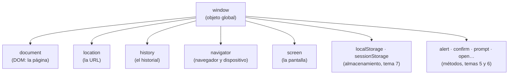

# 2. El navegador como objeto: el BOM

[⬅️ Volver a la unidad](./README.md)

## Índice

- [2.1. Qué es el BOM](#21-qué-es-el-bom)
  - [2.1.1. BOM frente a DOM](#211-bom-frente-a-dom)
- [2.2. `window`: el objeto global](#22-window-el-objeto-global)
- [2.3. `location`: la dirección de la página](#23-location-la-dirección-de-la-página)
  - [2.3.1. Las partes de una URL](#231-las-partes-de-una-url)
  - [2.3.2. Navegar desde el código](#232-navegar-desde-el-código)
  - [2.3.3. `URL` y `URLSearchParams`](#233-url-y-urlsearchparams)
- [2.4. `history`: el historial de la pestaña](#24-history-el-historial-de-la-pestaña)
- [2.5. `navigator`: el navegador y el dispositivo](#25-navigator-el-navegador-y-el-dispositivo)
  - [2.5.1. Detectar capacidades, no navegadores](#251-detectar-capacidades-no-navegadores)
- [2.6. `screen`: la pantalla](#26-screen-la-pantalla)
- [2.7. Ejemplo integrador: ficha del entorno](#27-ejemplo-integrador-ficha-del-entorno)
- [Resumen](#resumen)
- [Ejercicios de reflexión](#ejercicios-de-reflexión)

> **CE que trabaja este tema:** RA3 b.

---

## 2.1. Qué es el BOM

Cuando tu código se ejecuta en el navegador, no solo tiene la página: tiene la **ventana** donde está la página, la **dirección** que se ha cargado, el **historial** de la pestaña, información del **navegador** y de la **pantalla**… Todo eso es accesible desde JavaScript como objetos. Ese conjunto de objetos se llama **BOM** (*Browser Object Model*, modelo de objetos del navegador).



El diagrama muestra la jerarquía: todo cuelga de `window`, incluido `document`, la puerta de entrada al DOM que estudiarás en la UD5.

### 2.1.1. BOM frente a DOM

| | BOM | DOM |
|---|---|---|
| Qué representa | El **navegador**: ventana, URL, historial, pantalla | El **documento**: los elementos HTML de la página |
| Objeto principal | `window` | `document` |
| Estándar | No hubo uno único durante años; hoy lo recoge el estándar HTML del WHATWG | Estándar DOM del WHATWG |
| Ejemplos | `location.href`, `history.back()`, `navigator.language` | `document.title`, `document.querySelector('h1')` |
| Unidad | Esta (UD4) | UD5 |

> 💡 **Tip del Examinador**: "¿Qué diferencia hay entre BOM y DOM?" → El BOM son los objetos del **navegador** (`window`, `location`, `history`, `navigator`, `screen`); el DOM es la representación de la **página** como árbol de objetos (`document` y sus elementos). `document` es una propiedad de `window`, así que el DOM está dentro del BOM.

---

## 2.2. `window`: el objeto global

En el navegador, `window` tiene dos papeles:

1. Representa la **ventana** (o pestaña) del navegador: su tamaño, su posición, sus métodos (`open`, `close`, `alert`…).
2. Es el **objeto global**: todo lo global cuelga de él. Por eso puedes escribir `alert('Hola')` en lugar de `window.alert('Hola')`, y `location` en lugar de `window.location`.

```js
console.log(window === globalThis);     // true en el navegador
console.log(window.location === location); // true: es lo mismo
console.log(typeof window.document);    // 'object'
```

> 📝 **Nota del Profesor**: `globalThis` (ES2020) es el nombre estándar del objeto global en cualquier entorno: `window` en el navegador y `global` en Node.js. Si escribes código que debe funcionar en los dos (por ejemplo, una función que se prueba con Vitest en Node.js), comprueba antes si existe lo que necesitas: `typeof window !== 'undefined'`.

> ⚠️ **Cuidado**: Los nombres de las propiedades de `window` están "ocupados". Una variable global llamada `name`, `status` o `top` en un script clásico choca con `window.name`, `window.status` o `window.top`. Con módulos no pasa, porque sus variables no son globales (UD2).

---

## 2.3. `location`: la dirección de la página

### 2.3.1. Las partes de una URL

`location` contiene la URL de la página actual, ya separada en partes. Para la dirección `https://tienda.example:8080/catalogo/libros.html?orden=precio&pagina=2#ofertas`:

| Propiedad | Valor |
|-----------|-------|
| `href` | `'https://tienda.example:8080/catalogo/libros.html?orden=precio&pagina=2#ofertas'` |
| `protocol` | `'https:'` |
| `host` | `'tienda.example:8080'` |
| `hostname` | `'tienda.example'` |
| `port` | `'8080'` |
| `pathname` | `'/catalogo/libros.html'` |
| `search` | `'?orden=precio&pagina=2'` |
| `hash` | `'#ofertas'` |
| `origin` | `'https://tienda.example:8080'` |

El **origen** (*origin*: protocolo + servidor + puerto) es importante para la seguridad: dos páginas solo pueden comunicarse libremente si tienen el mismo origen (tema 6).

### 2.3.2. Navegar desde el código

| Código | Qué hace | ¿Deja entrada en el historial? |
|--------|----------|:---:|
| `location.href = url` o `location.assign(url)` | Carga otra página | ✅ (se puede volver con «Atrás») |
| `location.replace(url)` | Carga otra página sustituyendo la actual | ❌ |
| `location.reload()` | Recarga la página | — |
| `location.hash = 'seccion'` | Cambia el fragmento y salta a ese ancla, sin recargar | ✅ |

```js
// Tras cerrar sesión: que «Atrás» no vuelva a la zona privada
location.replace('/login.html');
```

### 2.3.3. `URL` y `URLSearchParams`

Leer los parámetros de `location.search` a mano (partir por `&` y por `=`, decodificar…) es incómodo y da errores. El objeto nativo **`URLSearchParams`** lo hace por ti, y **`URL`** analiza y construye direcciones completas.

```js
// En la página …/libros.html?orden=precio&pagina=2
const parametros = new URLSearchParams(location.search);
console.log(parametros.get('orden'));  // 'precio'
console.log(Number(parametros.get('pagina'))); // 2 (get devuelve texto)
console.log(parametros.get('autor'));  // null: no existe
console.log(parametros.has('pagina')); // true
```

```js
// Construir una URL con parámetros: los codifica automáticamente
const url = new URL('https://tienda.example/buscar');
url.searchParams.set('q', 'camiseta niño & niña');
url.searchParams.set('pagina', 1);
console.log(url.href);
// 'https://tienda.example/buscar?q=camiseta+ni%C3%B1o+%26+ni%C3%B1a&pagina=1'

for (const [clave, valor] of url.searchParams) {
  console.log(clave, valor); // q camiseta niño & niña · pagina 1
}
```

> ✅ **Buena práctica**: Para leer o construir parámetros de una URL, usa `URLSearchParams` o `URL` en lugar de concatenar textos con `encodeURIComponent` (UD3): codifican y decodifican solos, y `URLSearchParams` es iterable.

> 📝 **Nota del Profesor**: `URLSearchParams` codifica los espacios como `+` y `encodeURIComponent` como `%20`. Los dos son válidos en los parámetros de una URL y los servidores los entienden igual.

---

## 2.4. `history`: el historial de la pestaña

`history` permite moverse por el historial de la pestaña, como los botones del navegador. Por seguridad, **no** permite leer qué páginas hay en él.

| Código | Qué hace |
|--------|----------|
| `history.back()` | Como el botón «Atrás» |
| `history.forward()` | Como el botón «Adelante» |
| `history.go(n)` | Avanza o retrocede `n` páginas (`go(-2)`) |
| `history.length` | Número de entradas del historial de la pestaña |
| `history.pushState(estado, '', url)` | Añade una entrada **sin recargar** la página y cambia la URL de la barra |
| `history.replaceState(estado, '', url)` | Sustituye la entrada actual sin recargar |

`pushState` es la base de las **aplicaciones de una sola página** (*SPA*): la página cambia su contenido con JavaScript y actualiza la URL, para que se pueda compartir el enlace y funcione el botón «Atrás». Cuando el usuario pulsa «Atrás» en una entrada creada así, el navegador lanza el evento `popstate` (los eventos, en la UD6):

```js
// Mostrar la sección de ofertas sin recargar y reflejarlo en la URL
history.pushState({ seccion: 'ofertas' }, '', '?seccion=ofertas');

addEventListener('popstate', (evento) => {
  console.log('Volver a', evento.state?.seccion ?? 'inicio');
});
```

> 📝 **Nota del Profesor**: No tendrás que programar un enrutador con `pushState`: Angular lo hace por ti con su *router* (UD8). Pero conviene saber que, por debajo, es esto.

---

## 2.5. `navigator`: el navegador y el dispositivo

`navigator` da información sobre el navegador y el dispositivo, y es la puerta de entrada a muchas APIs del navegador.

| Propiedad o API | Qué ofrece | Ejemplo |
|-----------------|------------|---------|
| `navigator.language`, `navigator.languages` | Idioma preferido del usuario | `'es-ES'` |
| `navigator.onLine` | Si hay conexión (orientativo) | `true` |
| `navigator.cookieEnabled` | Si se pueden guardar cookies | `true` |
| `navigator.userAgent` | Texto que identifica el navegador | `'Mozilla/5.0 (…) Chrome/…'` |
| `navigator.hardwareConcurrency` | Número de núcleos lógicos | `8` |
| `navigator.geolocation` | Posición del usuario, con su permiso | Ver ejercicio de capacidades |
| `navigator.clipboard` | Copiar y pegar (tema 5) | `navigator.clipboard.writeText('…')` |

```js
const idioma = navigator.language;           // por ejemplo, 'es-ES'
const euros = new Intl.NumberFormat(idioma, { style: 'currency', currency: 'EUR' });
console.log(euros.format(9.5));               // formato del idioma del usuario
```

### 2.5.1. Detectar capacidades, no navegadores

Antes se miraba `navigator.userAgent` para decidir qué podía hacer el navegador ("si es Internet Explorer, entonces…"). Es una mala práctica: el texto se puede falsificar, todos los navegadores dicen ser "Mozilla" y cambia con cada versión.

Lo correcto es la **detección de capacidades** (*feature detection*): comprobar si existe lo que vas a usar.

```js
if ('geolocation' in navigator) {
  console.log('✅ Se puede pedir la ubicación');
} else {
  console.log('❌ Sin geolocalización: se pedirá el código postal');
}

const tieneClipboard = typeof navigator.clipboard?.writeText === 'function';
const tieneIndexedDB = 'indexedDB' in window;
```

> ✅ **Buena práctica**: Detecta la **capacidad** que necesitas (`'geolocation' in navigator`), nunca el **navegador**. Y prevé siempre una alternativa si no está.

> 💡 **Tip del Examinador**: "¿Por qué no se debe usar `navigator.userAgent` para decidir qué funciones usar?" → Porque no es fiable (se puede cambiar, todos los navegadores imitan a otros) y no dice qué APIs están disponibles. Se usa la detección de capacidades.

---

## 2.6. `screen`: la pantalla

`screen` describe la **pantalla física** del dispositivo, no la ventana:

| Propiedad | Qué es |
|-----------|--------|
| `screen.width`, `screen.height` | Tamaño de la pantalla en píxeles CSS |
| `screen.availWidth`, `screen.availHeight` | Espacio disponible (sin la barra de tareas del sistema) |
| `screen.colorDepth` | Bits de color |
| `screen.orientation.type` | `'landscape-primary'`, `'portrait-primary'`… |

| | Tamaño de la **pantalla** | Tamaño de la **ventana** (tema 3) |
|---|---|---|
| Propiedades | `screen.width`, `screen.height` | `innerWidth`, `innerHeight` |
| Cambia al redimensionar la ventana | ❌ | ✅ |

> 📝 **Nota del Profesor**: Para adaptar el diseño al tamaño, se usan las *media queries* de CSS (y `matchMedia` desde JavaScript, tema 3), no `screen.width`. `screen` sirve para datos informativos (estadísticas, decidir el tamaño de una ventana emergente).

---

## 2.7. Ejemplo integrador: ficha del entorno

Una página que muestra en la consola una ficha del entorno en el que se está viendo. Se abre con un servidor local, con una dirección como `http://localhost:5500/ficha.html?modo=detalle#inicio`.

```html
<!-- ficha.html -->
<!doctype html>
<html lang="es">
  <head>
    <meta charset="utf-8" />
    <title>Ficha del entorno</title>
    <script type="module" src="ficha.js"></script>
  </head>
  <body>
    <h1>Abre la consola (F12)</h1>
  </body>
</html>
```

```js
// ficha.js
const parametros = new URLSearchParams(location.search);
const detalle = parametros.get('modo') === 'detalle';

console.group('🌐 Página');
console.log(`Origen: ${location.origin}`);
console.log(`Ruta: ${location.pathname} · fragmento: ${location.hash || '(ninguno)'}`);
console.log(`Entradas en el historial de la pestaña: ${history.length}`);
console.groupEnd();

console.group('🧭 Navegador');
console.log(`Idioma: ${navigator.language} · conexión: ${navigator.onLine ? 'sí' : 'no'}`);
console.log(`Geolocalización: ${'geolocation' in navigator ? 'disponible' : 'no disponible'}`);
console.log(`Portapapeles: ${typeof navigator.clipboard?.writeText === 'function' ? 'disponible' : 'no disponible'}`);
console.groupEnd();

console.group('🖥️ Pantalla y ventana');
console.log(`Pantalla: ${screen.width} × ${screen.height} · ventana: ${innerWidth} × ${innerHeight}`);
if (detalle) {
  console.log(`Orientación: ${screen.orientation?.type ?? 'desconocida'} · color: ${screen.colorDepth} bits`);
}
console.groupEnd();
```

```text
// Salida (depende del navegador y del equipo):
🌐 Página
  Origen: http://localhost:5500
  Ruta: /ficha.html · fragmento: #inicio
  Entradas en el historial de la pestaña: 1
🧭 Navegador
  Idioma: es-ES · conexión: sí
  Geolocalización: disponible
  Portapapeles: disponible
🖥️ Pantalla y ventana
  Pantalla: 1920 × 1080 · ventana: 1280 × 720
  Orientación: landscape-primary · color: 24 bits
```

| Objeto | Para qué |
|--------|----------|
| `URLSearchParams` y `location` | Leer el modo de la URL y sus partes |
| `history` | Saber cuántas entradas tiene la pestaña |
| `navigator` | Idioma, conexión y detección de capacidades |
| `screen` y `window` | Tamaño de la pantalla y de la ventana |

---

## Resumen

- El **BOM** es el conjunto de objetos del navegador: `window`, `location`, `history`, `navigator`, `screen`… El **DOM** (`document`) cuelga de `window`.
- `window` es la ventana y el **objeto global** (`globalThis` en el navegador).
- `location` da las partes de la URL (`href`, `pathname`, `search`, `hash`, `origin`…) y permite navegar (`assign`, `replace`, `reload`).
- **`URLSearchParams`** lee y construye parámetros; **`URL`** analiza y construye direcciones, con la codificación automática.
- `history` mueve por el historial (`back`, `forward`, `go`) y `pushState` cambia la URL sin recargar (base de las SPA).
- `navigator` informa del idioma, la conexión y las APIs disponibles. Se **detectan capacidades**, no navegadores.
- `screen` describe la pantalla física; el tamaño de la ventana está en `innerWidth` e `innerHeight`.

## Ejercicios de reflexión

1. Escribe en la consola de una página cualquiera `location` y despliega el objeto. Identifica cada parte de la URL.
2. ¿Qué diferencia hay entre `location.assign(url)` y `location.replace(url)`? ¿Cuándo usarías cada una?
3. ¿Qué devuelve `new URLSearchParams('?a=1&a=2').getAll('a')`? ¿Y `.get('a')`?
4. ¿Por qué `history` no deja leer las direcciones que ha visitado el usuario?
5. Escribe una comprobación que decida si se puede usar la API de notificaciones del navegador sin mirar `userAgent`.

---

[⬅️ Volver a la unidad](./README.md)
