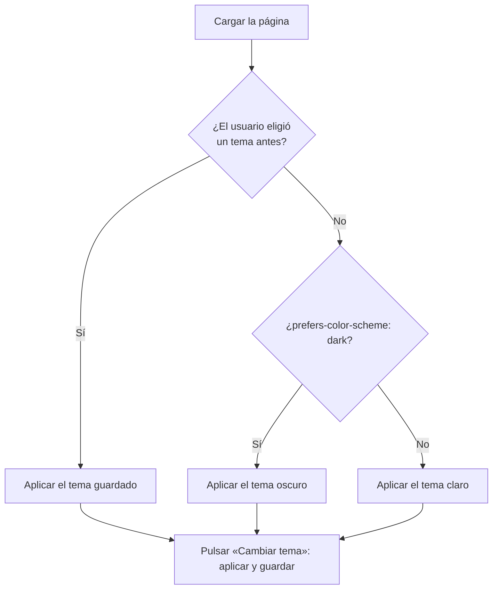

# 3. La apariencia de la ventana

[⬅️ Volver a la unidad](./README.md)

## Índice

- [3.1. Qué se puede cambiar desde el código](#31-qué-se-puede-cambiar-desde-el-código)
- [3.2. El tamaño de la ventana](#32-el-tamaño-de-la-ventana)
- [3.3. El desplazamiento (_scroll_)](#33-el-desplazamiento-scroll)
- [3.4. El título y el aspecto del documento](#34-el-título-y-el-aspecto-del-documento)
  - [3.4.1. El título de la pestaña](#341-el-título-de-la-pestaña)
  - [3.4.2. Clases, atributos y variables CSS](#342-clases-atributos-y-variables-css)
- [3.5. `matchMedia`: consultas de medios desde JavaScript](#35-matchmedia-consultas-de-medios-desde-javascript)
- [3.6. Modo oscuro](#36-modo-oscuro)
- [3.7. Pantalla completa e impresión](#37-pantalla-completa-e-impresión)
- [3.8. Lo que ya no se puede hacer](#38-lo-que-ya-no-se-puede-hacer)
- [3.9. Ejemplo integrador: lector cómodo](#39-ejemplo-integrador-lector-cómodo)
- [Resumen](#resumen)
- [Ejercicios de reflexión](#ejercicios-de-reflexión)

> **CE que trabaja este tema:** RA3 c.

---

## 3.1. Qué se puede cambiar desde el código

Con los objetos predefinidos puedes cambiar el **aspecto del navegador** (lo que se ve fuera de la página: el título de la pestaña, el desplazamiento, la pantalla completa) y el **aspecto del documento** (colores, tema, tamaño de letra).

| Qué | Con qué | Tema |
|-----|---------|------|
| Saber el tamaño de la ventana | `innerWidth`, `innerHeight` | 3.2 |
| Desplazar la página | `scrollTo`, `scrollBy`, `scrollY` | 3.3 |
| Título de la pestaña | `document.title` | 3.4 |
| Colores, tema y tamaños | `classList`, `dataset`, variables CSS | 3.4 y 3.6 |
| Adaptarse a la pantalla y a las preferencias | `matchMedia` | 3.5 y 3.6 |
| Pantalla completa, imprimir | `requestFullscreen`, `print` | 3.7 |

> 📝 **Nota del Profesor**: En este tema usarás algunas cosas del DOM (`document.documentElement`, `classList`, `querySelector`) y algún evento (`addEventListener`) porque sin ellas no se puede cambiar el aspecto. Las estudiarás a fondo en las UD5 y UD6; aquí basta con usarlas como se muestran.

> ✅ **Buena práctica**: El **estilo** se escribe en el CSS. Desde JavaScript se cambian **clases**, **atributos** o **variables CSS**, no propiedades sueltas (`elemento.style.color = …`). Así la separación de capas de la UD1 se mantiene.

---

## 3.2. El tamaño de la ventana

| Propiedad | Qué mide |
|-----------|----------|
| `innerWidth`, `innerHeight` | El área donde se ve la página (con barras de desplazamiento) |
| `outerWidth`, `outerHeight` | La ventana entera, con barras de herramientas y bordes |
| `document.documentElement.clientWidth` | El ancho útil de la página, sin la barra de desplazamiento |
| `devicePixelRatio` | Píxeles físicos por píxel CSS (2 o 3 en pantallas de alta densidad) |

```js
console.log(`Ventana: ${innerWidth} × ${innerHeight}`);
console.log(`Densidad: ${devicePixelRatio}`);

addEventListener('resize', () => {
  console.log(`Nuevo tamaño: ${innerWidth} × ${innerHeight}`);
});
```

> ⚠️ **Cuidado**: El evento `resize` se lanza muchísimas veces mientras se arrastra el borde de la ventana. No hagas cálculos pesados en él. Y para adaptar el diseño, mejor `matchMedia` (apartado 3.5), que solo avisa cuando se cruza un límite.

---

## 3.3. El desplazamiento (_scroll_)

| Código | Qué hace |
|--------|----------|
| `scrollX`, `scrollY` | Píxeles desplazados en horizontal y en vertical |
| `scrollTo({ top, left, behavior })` | Lleva a una posición absoluta |
| `scrollBy({ top, left, behavior })` | Desplaza una cantidad relativa |
| `elemento.scrollIntoView({ behavior })` | Desplaza hasta que se ve un elemento (DOM) |
| `document.documentElement.scrollHeight` | Altura total de la página |

```js
// Botón «Volver arriba»: desplazamiento suave
document.querySelector('#arriba').addEventListener('click', () => {
  scrollTo({ top: 0, behavior: 'smooth' });
});

// Porcentaje leído de la página
function porcentajeLeido() {
  const recorrible = document.documentElement.scrollHeight - innerHeight;
  return recorrible > 0 ? Math.round((scrollY / recorrible) * 100) : 100;
}
```

> ✅ **Buena práctica**: Respeta a quien ha pedido menos animaciones en su sistema: si `matchMedia('(prefers-reduced-motion: reduce)').matches` es `true`, usa `behavior: 'auto'` en lugar de `'smooth'`.

---

## 3.4. El título y el aspecto del documento

### 3.4.1. El título de la pestaña

`document.title` lee y cambia el texto de la pestaña (el `<title>` del HTML). Es la forma más sencilla de cambiar el aspecto del navegador, y se usa para avisar de algo cuando el usuario está en otra pestaña:

```js
const tituloOriginal = document.title;
let pendientes = 3;
document.title = `(${pendientes}) ${tituloOriginal}`; // '(3) Bandeja de entrada'
```

### 3.4.2. Clases, atributos y variables CSS

El elemento raíz de la página es `document.documentElement` (el `<html>`). Cambiar sus clases, sus atributos o sus **variables CSS** cambia el aspecto de **toda** la página, porque el CSS los usa en cascada.

```css
/* estilos.css */
:root {
  --color-fondo: #ffffff;
  --color-texto: #1b1f3b;
  --tamano-letra: 1rem;
}
:root[data-tema='oscuro'] {
  --color-fondo: #1b1f3b;
  --color-texto: #f1f1f1;
}
body {
  background: var(--color-fondo);
  color: var(--color-texto);
  font-size: var(--tamano-letra);
}
```

```js
const raiz = document.documentElement;

raiz.dataset.tema = 'oscuro';                       // <html data-tema="oscuro">
raiz.style.setProperty('--tamano-letra', '1.25rem'); // cambia una variable CSS
raiz.classList.toggle('alto-contraste');           // añade o quita una clase

console.log(getComputedStyle(raiz).getPropertyValue('--color-fondo').trim()); // '#1b1f3b'
```

| Forma | Ejemplo | Úsala para |
|-------|---------|-----------|
| Atributo `data-*` (`dataset`) | `raiz.dataset.tema = 'oscuro'` | Estados con varios valores (tema, tamaño) |
| Clase (`classList`) | `raiz.classList.toggle('alto-contraste')` | Estados de sí o no |
| Variable CSS (`style.setProperty`) | `setProperty('--tamano-letra', '1.25rem')` | Valores continuos (tamaño, color elegido) |

> 💡 **Tip del Examinador**: "¿Cómo cambiarías el tema de una página desde JavaScript sin escribir estilos en el código?" → Cambiando un atributo o una clase del elemento raíz (`document.documentElement.dataset.tema = 'oscuro'`) y definiendo en el CSS los colores de cada tema con variables CSS.

---

## 3.5. `matchMedia`: consultas de medios desde JavaScript

`matchMedia(consulta)` evalúa una **consulta de medios** (*media query*) de CSS desde JavaScript. Devuelve un objeto con `matches` (si se cumple ahora) que además **avisa cuando cambia**.

```js
const movil = matchMedia('(max-width: 600px)');
console.log(movil.matches); // true si la ventana mide 600 px o menos

movil.addEventListener('change', (evento) => {
  console.log(evento.matches ? '📱 Vista móvil' : '🖥️ Vista de escritorio');
});
```

Consultas útiles:

| Consulta | Se cumple si… |
|----------|---------------|
| `(max-width: 600px)` | La ventana mide 600 px o menos de ancho |
| `(orientation: portrait)` | Es más alta que ancha |
| `(prefers-color-scheme: dark)` | El usuario prefiere el modo oscuro en su sistema |
| `(prefers-reduced-motion: reduce)` | El usuario prefiere menos animaciones |
| `print` | Se está imprimiendo |

> 📝 **Nota del Profesor**: Si algo se puede hacer **solo con CSS** (`@media`), hazlo en el CSS. `matchMedia` es para cuando el **código** tiene que decidir algo según el tamaño o las preferencias: cargar menos datos en el móvil, cambiar el número de elementos de una lista, guardar el tema…

---

## 3.6. Modo oscuro

Un selector de tema bien hecho tiene en cuenta tres cosas:

1. La **preferencia del sistema** (`prefers-color-scheme`), que se aplica por defecto.
2. La **elección del usuario** en la página, que tiene prioridad y se recuerda (con `localStorage`, tema 7).
3. Los **cambios** de la preferencia del sistema mientras la página está abierta (si el usuario no ha elegido).



El diagrama muestra la prioridad: lo que eligió el usuario manda; si no eligió nada, se sigue al sistema.

```js
// tema.js
const prefiereOscuro = matchMedia('(prefers-color-scheme: dark)');

function aplicarTema(tema) {
  document.documentElement.dataset.tema = tema;
  document.querySelector('#cambiar-tema').textContent = tema === 'oscuro' ? '☀️ Claro' : '🌙 Oscuro';
}

const temaGuardado = localStorage.getItem('tema'); // tema 7
aplicarTema(temaGuardado ?? (prefiereOscuro.matches ? 'oscuro' : 'claro'));

prefiereOscuro.addEventListener('change', (evento) => {
  if (localStorage.getItem('tema') === null) aplicarTema(evento.matches ? 'oscuro' : 'claro');
});

document.querySelector('#cambiar-tema').addEventListener('click', () => {
  const nuevo = document.documentElement.dataset.tema === 'oscuro' ? 'claro' : 'oscuro';
  aplicarTema(nuevo);
  localStorage.setItem('tema', nuevo);
});
```

---

## 3.7. Pantalla completa e impresión

```js
const visor = document.querySelector('#visor');

document.querySelector('#completa').addEventListener('click', async () => {
  if (document.fullscreenElement) {
    await document.exitFullscreen();
  } else {
    await visor.requestFullscreen(); // solo funciona como respuesta a una acción del usuario
  }
});

document.querySelector('#imprimir').addEventListener('click', () => print());
```

- `elemento.requestFullscreen()` pone un elemento (un vídeo, una presentación, un juego) a pantalla completa; `document.exitFullscreen()` sale y `document.fullscreenElement` dice qué elemento lo está.
- `print()` abre el diálogo de impresión. Lo que se imprime se adapta con `@media print` en el CSS.
- `async`/`await` aparecen porque estas funciones devuelven promesas: las verás en la UD7. Aquí basta con escribirlas así.

> ⚠️ **Cuidado**: Las acciones que afectan a la experiencia del usuario (pantalla completa, abrir ventanas, copiar al portapapeles, reproducir sonido) solo se permiten como **respuesta a una acción del usuario**, como un clic. Si las llamas al cargar la página, el navegador las rechaza.

---

## 3.8. Lo que ya no se puede hacer

En los primeros años de la web, las páginas podían mover, redimensionar y cerrar la ventana del navegador, cambiar la barra de estado… Se abusó tanto (ventanas que huían del ratón, anuncios que no se dejaban cerrar) que los navegadores lo limitaron:

| Método | Hoy |
|--------|-----|
| `window.moveTo`, `window.resizeTo` | Solo funcionan en ventanas **abiertas por la propia página** con `window.open` (tema 6), y no en todas |
| `window.close()` | Solo cierra ventanas que abrió el propio código |
| `window.status` (texto de la barra de estado) | Ignorado |
| Quitar barras de herramientas o la barra de direcciones | Ignorado por motivos de seguridad |

> 💡 **Tip del Examinador**: "¿Puede una página cambiar el tamaño de la ventana del navegador?" → Solo el de las ventanas que ella misma ha abierto con `window.open`, y con limitaciones según el navegador. La ventana principal del usuario no se puede mover ni redimensionar desde el código.

---

## 3.9. Ejemplo integrador: lector cómodo

Una página de lectura con tres mejoras: tema claro u oscuro según el sistema, tamaño de letra ajustable y el porcentaje leído en el título de la pestaña.

```html
<!-- lector.html -->
<!doctype html>
<html lang="es">
  <head>
    <meta charset="utf-8" />
    <title>El Quijote</title>
    <link rel="stylesheet" href="lector.css" />
    <script type="module" src="lector.js"></script>
  </head>
  <body>
    <nav>
      <button id="menos">A−</button>
      <button id="mas">A+</button>
      <button id="cambiar-tema">🌙 Oscuro</button>
    </nav>
    <article><!-- texto largo --></article>
  </body>
</html>
```

```js
// lector.js
const raiz = document.documentElement;
const tituloOriginal = document.title;
const prefiereOscuro = matchMedia('(prefers-color-scheme: dark)');
let tamano = 1;

function aplicarTema(tema) {
  raiz.dataset.tema = tema;
  document.querySelector('#cambiar-tema').textContent = tema === 'oscuro' ? '☀️ Claro' : '🌙 Oscuro';
}

function cambiarTamano(incremento) {
  tamano = Math.min(2, Math.max(0.75, tamano + incremento)); // entre 0,75 y 2 rem
  raiz.style.setProperty('--tamano-letra', `${tamano}rem`);
}

function actualizarTitulo() {
  const recorrible = raiz.scrollHeight - innerHeight;
  const leido = recorrible > 0 ? Math.round((scrollY / recorrible) * 100) : 100;
  document.title = `(${leido} %) ${tituloOriginal}`;
}

aplicarTema(prefiereOscuro.matches ? 'oscuro' : 'claro');
prefiereOscuro.addEventListener('change', (e) => aplicarTema(e.matches ? 'oscuro' : 'claro'));
document.querySelector('#cambiar-tema').addEventListener('click', () => {
  aplicarTema(raiz.dataset.tema === 'oscuro' ? 'claro' : 'oscuro');
});
document.querySelector('#menos').addEventListener('click', () => cambiarTamano(-0.125));
document.querySelector('#mas').addEventListener('click', () => cambiarTamano(0.125));
addEventListener('scroll', actualizarTitulo);
actualizarTitulo();
```

| Qué cambia | Con qué |
|------------|---------|
| Colores de toda la página | Atributo `data-tema` en `<html>` + variables CSS |
| Tamaño de letra | Variable CSS `--tamano-letra` con `style.setProperty` |
| Preferencia del sistema | `matchMedia('(prefers-color-scheme: dark)')` y su evento `change` |
| Título de la pestaña | `document.title` con el porcentaje calculado con `scrollY`, `innerHeight` y `scrollHeight` |

---

## Resumen

- Desde el código se puede cambiar el aspecto del **navegador** (título, desplazamiento, pantalla completa) y del **documento** (tema, colores, tamaños).
- `innerWidth`/`innerHeight` miden la ventana; `resize` avisa de cada cambio.
- `scrollX`/`scrollY` dicen cuánto se ha desplazado; `scrollTo`, `scrollBy` y `scrollIntoView` desplazan.
- `document.title` cambia el texto de la pestaña.
- El aspecto se cambia con **clases**, **atributos `data-*`** y **variables CSS** del elemento raíz, no escribiendo estilos sueltos.
- `matchMedia` evalúa consultas de medios y avisa con `change`: tamaño, orientación, `prefers-color-scheme`, `prefers-reduced-motion`.
- Un buen modo oscuro sigue al sistema salvo que el usuario elija otro, y recuerda la elección.
- `requestFullscreen` y `print` necesitan una acción del usuario. Mover, redimensionar o cerrar la ventana principal ya no se permite.

## Ejercicios de reflexión

1. ¿Qué diferencia hay entre `innerWidth` y `screen.width`? Pruébalo redimensionando la ventana.
2. ¿Por qué es mejor cambiar `data-tema` en `<html>` que cambiar el color de cada elemento con `style`?
3. Escribe una consulta con `matchMedia` que sea cierta en móviles en vertical.
4. ¿Por qué el navegador no deja poner la pantalla completa al cargar la página?
5. En el ejemplo integrador, ¿qué pasa si el usuario elige un tema y después cambia la preferencia del sistema? ¿Cómo lo resolverías con `localStorage`?

---

[⬅️ Volver a la unidad](./README.md)
