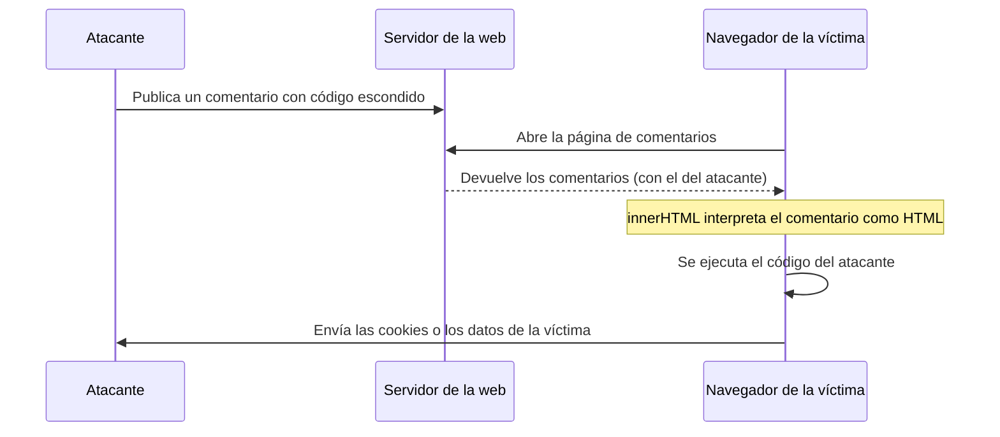

# 4. Generar contenido desde el código

[⬅️ Volver a la unidad](./README.md)

## Índice

- [4.1. Por qué generar contenido](#41-por-qué-generar-contenido)
- [4.2. `document.write`: historia y por qué no](#42-documentwrite-historia-y-por-qué-no)
- [4.3. `textContent`: insertar texto](#43-textcontent-insertar-texto)
- [4.4. `innerHTML`: insertar etiquetas](#44-innerhtml-insertar-etiquetas)
  - [4.4.1. El riesgo: inyección de código (XSS)](#441-el-riesgo-inyección-de-código-xss)
  - [4.4.2. Escapar el texto](#442-escapar-el-texto)
- [4.5. Generar HTML con plantillas de texto](#45-generar-html-con-plantillas-de-texto)
- [4.6. Generar textos legibles](#46-generar-textos-legibles)
- [4.7. Qué método usar](#47-qué-método-usar)
- [4.8. Ejemplo integrador: tabla de resultados](#48-ejemplo-integrador-tabla-de-resultados)
- [Resumen](#resumen)
- [Ejercicios de reflexión](#ejercicios-de-reflexión)

> **CE que trabaja este tema:** RA3 d.

---

## 4.1. Por qué generar contenido

Casi ninguna página real tiene todo su contenido escrito en el HTML: la lista de productos, los resultados de una búsqueda o los mensajes de un chat se **generan** con JavaScript a partir de datos (de un array, del almacenamiento o de un servidor).

Generar contenido tiene dos partes:

1. **Generar el texto**: convertir los datos en frases legibles («3 productos · 74,30 €»), con `Intl` y plantillas de texto.
2. **Insertarlo en la página**: como texto o como etiquetas HTML.

```js
const productos = ['Libro', 'Lámpara'];
document.querySelector('#resumen').textContent = `Tienes ${productos.length} productos en el carrito`;
```

> 📝 **Nota del Profesor**: `document.querySelector('#resumen')` busca el elemento con `id="resumen"`. Lo estudiarás a fondo en la UD5, junto con la creación de elementos con `createElement`. Aquí te centras en **qué** se inserta y en sus **riesgos**.

---

## 4.2. `document.write`: historia y por qué no

En los primeros años de la web, `document.write(texto)` era la forma de generar contenido: escribía el texto en el punto de la página donde estaba el `<script>`, mientras el navegador la leía.

```html
<p>Hoy es <script>document.write(new Date().toLocaleDateString('es-ES'));</script></p>
```

Hoy **no se usa**:

| Problema | Por qué |
|----------|---------|
| **Borra la página** | Si se llama después de que la página haya cargado (por ejemplo, al pulsar un botón), sustituye **todo** el documento por el texto |
| **Bloquea la carga** | El navegador tiene que parar de leer el HTML hasta ejecutar el script |
| **No funciona con módulos** | En un `<script type="module">` (diferido) la página ya está cargada |
| **Mezcla capas** | Obliga a poner JavaScript dentro del HTML |

> ⚠️ **Cuidado**: Si ves `document.write` en un tutorial antiguo o en código heredado, sustitúyelo por `textContent` o por la creación de elementos. Los navegadores incluso bloquean algunos usos en conexiones lentas.

> 💡 **Tip del Examinador**: "¿Por qué no se debe usar `document.write`?" → Porque si se ejecuta después de cargar la página la borra entera, bloquea la carga mientras se ejecuta, no funciona en módulos y mezcla JavaScript con HTML.

---

## 4.3. `textContent`: insertar texto

`elemento.textContent` lee o sustituye el **texto** de un elemento. Lo que asignas se muestra **tal cual**: si contiene `<` o `>`, se ven esos caracteres; nunca se interpretan como etiquetas.

```html
<p id="saludo"></p>
```

```js
const nombre = 'Ana <b>García</b>';
document.querySelector('#saludo').textContent = `Hola, ${nombre}`;
// En la página se ve literalmente: Hola, Ana <b>García</b>
```

Es la forma **segura** de mostrar cualquier dato que venga del usuario, del almacenamiento o de un servidor.

> ✅ **Buena práctica**: Para insertar **texto**, usa siempre `textContent`. Solo cuando necesites **etiquetas**, recurre a `innerHTML` (con las precauciones del apartado 4.4) o, mejor, a crear elementos (UD5).

---

## 4.4. `innerHTML`: insertar etiquetas

`elemento.innerHTML` lee o sustituye el **HTML** de un elemento: lo que asignas se **interpreta** como etiquetas.

```js
document.querySelector('#lista').innerHTML = '<li>Pan</li><li>Leche</li>';
// La página muestra una lista con dos elementos
```

Es muy cómodo para generar estructuras completas (listas, tablas, tarjetas) a partir de datos. Pero tiene un riesgo serio.

### 4.4.1. El riesgo: inyección de código (XSS)

Si metes en `innerHTML` un texto que viene de fuera **sin tratarlo**, quien escribió ese texto puede inyectar etiquetas y **ejecutar código** en la página de otro usuario. Se llama **XSS** (*Cross-Site Scripting*) y es una de las vulnerabilidades más frecuentes de la web.

```js
// El usuario escribe esto como «nombre» en un formulario de comentarios:
const nombre = '';

// ❌ Peligroso: la etiqueta se interpreta y su código se ejecuta
document.querySelector('#comentario').innerHTML = `<strong>${nombre}</strong> dice: ¡Hola!`;
```

La imagen no existe, el navegador ejecuta su `onerror` y el código del atacante se ejecuta con los permisos de **tu** página: puede leer cookies, cambiar el contenido o enviar datos a otro servidor.



El diagrama muestra el ataque: el código no lo ejecuta el atacante, sino el navegador de **otra persona** que visita la página.

> ⚠️ **Cuidado**: **Nunca** pongas en `innerHTML` datos que no hayas escrito tú (lo que escribe un usuario, lo que viene del almacenamiento, de la URL o de un servidor) sin escaparlos antes.

### 4.4.2. Escapar el texto

**Escapar** es sustituir los caracteres especiales del HTML por sus entidades, para que se muestren como texto y no se interpreten:

| Carácter | Entidad |
|----------|---------|
| `&` | `&amp;` |
| `<` | `&lt;` |
| `>` | `&gt;` |
| `"` | `&quot;` |
| `'` | `&#39;` |

```js
/**
 * Escapa los caracteres especiales del HTML para insertar un texto con seguridad en innerHTML.
 * @param {string} texto
 * @returns {string}
 */
export function escaparHTML(texto) {
  return String(texto)
    .replaceAll('&', '&amp;') // el primero: si no, se escaparían las entidades nuevas
    .replaceAll('<', '&lt;')
    .replaceAll('>', '&gt;')
    .replaceAll('"', '&quot;')
    .replaceAll("'", '&#39;');
}

console.log(escaparHTML(''));
// '&lt;img src=&quot;x&quot; onerror=&quot;alert(1)&quot;&gt;'
```

```js
// ✅ Seguro: el nombre se muestra como texto
document.querySelector('#comentario').innerHTML = `<strong>${escaparHTML(nombre)}</strong> dice: ¡Hola!`;
```

> 📝 **Nota del Profesor**: Los frameworks como Angular (UD8) escapan automáticamente todo lo que muestras en sus plantillas: es una de las razones por las que se usan. Cuando trabajas sin framework, la responsabilidad es tuya.

---

## 4.5. Generar HTML con plantillas de texto

Las plantillas de texto (UD2) y las operaciones agregadas (UD3) forman la técnica más habitual para generar HTML a partir de un array: `map` convierte cada dato en un trozo de HTML y `join('')` los une.

```js
const productos = [
  { nombre: 'Libro', precio: 19.9, stock: 3 },
  { nombre: 'Lámpara <LED>', precio: 34.5, stock: 0 },
];
const euros = new Intl.NumberFormat('es-ES', { style: 'currency', currency: 'EUR' });

function tarjetaProducto({ nombre, precio, stock }) {
  return `
    <article class="producto ${stock === 0 ? 'agotado' : ''}">
      <h2>${escaparHTML(nombre)}</h2>
      <p>${euros.format(precio)}</p>
      <p>${stock > 0 ? `${stock} disponibles` : 'Agotado'}</p>
    </article>`;
}

document.querySelector('#catalogo').innerHTML = productos.map(tarjetaProducto).join('');
```

- Una **función por componente** (`tarjetaProducto`) mantiene el código ordenado y se puede probar con tests: recibe datos y devuelve un texto.
- **Escapa** cada dato de texto (`nombre`). Los que tú formateas (`euros.format`, números) no necesitan escaparse.
- `join('')` es necesario: sin él, el array se convertiría en texto con comas entre los elementos.

> ⚠️ **Cuidado**: Asignar `innerHTML` **sustituye** todo el contenido del elemento y vuelve a crear los elementos. Si lo haces dentro de un bucle con `+=`, el navegador regenera la lista entera en cada vuelta. Genera todo el texto y asígnalo **una vez**.

---

## 4.6. Generar textos legibles

Generar contenido no es solo insertar: es también **redactar** bien los datos. Los objetos nativos del tema 1 ayudan:

```js
const lista = new Intl.ListFormat('es');
const reglas = new Intl.PluralRules('es');
const relativo = new Intl.RelativeTimeFormat('es', { numeric: 'auto' });

function resumenCarrito(nombres) {
  const n = nombres.length;
  if (n === 0) return 'Tu carrito está vacío';
  const palabra = reglas.select(n) === 'one' ? 'producto' : 'productos';
  return `${n} ${palabra}: ${lista.format(nombres)}`;
}

console.log(resumenCarrito([]));                       // 'Tu carrito está vacío'
console.log(resumenCarrito(['pan']));                  // '1 producto: pan'
console.log(resumenCarrito(['pan', 'leche', 'café'])); // '3 productos: pan, leche y café'
console.log(relativo.format(-2, 'day'));               // 'anteayer'
```

---

## 4.7. Qué método usar

| Necesidad | Método | Seguro con datos externos |
|-----------|--------|:---:|
| Mostrar un texto (nombre, mensaje, resultado) | `textContent` | ✅ |
| Generar una estructura (lista, tabla, tarjeta) con tus propios datos | `innerHTML` con plantillas | ✅ si escapas cada dato |
| Añadir HTML sin borrar lo que hay | `insertAdjacentHTML('beforeend', html)` | ✅ si escapas cada dato |
| Crear elementos uno a uno y añadirlos | `createElement` + `append` (UD5) | ✅ |
| Escribir mientras la página carga | `document.write` | ❌ No se usa |

```js
// Añadir un mensaje al final de un chat sin borrar los anteriores
const chat = document.querySelector('#chat');
chat.insertAdjacentHTML('beforeend', `<p><b>${escaparHTML('Luis')}</b>: ${escaparHTML('¿Quedamos?')}</p>`);
```

> 💡 **Tip del Examinador**: "¿Qué diferencia hay entre `textContent` e `innerHTML`?" → `textContent` inserta texto tal cual (las etiquetas se ven como caracteres, es seguro); `innerHTML` interpreta el texto como HTML (crea elementos, pero con datos externos sin escapar permite ataques XSS).

---

## 4.8. Ejemplo integrador: tabla de resultados

Una página muestra la clasificación de una liga a partir de un array de datos. La función que genera el HTML es pura y está en su propio módulo, separada de la que lo inserta en la página.

```js
// tabla.js: genera el HTML (se puede probar con tests en Node.js)
import { escaparHTML } from './escapar.js';

const porcentaje = new Intl.NumberFormat('es-ES', { style: 'percent' });

/**
 * Genera la tabla de clasificación, ordenada por puntos.
 * @param {{ equipo: string, ganados: number, empatados: number, perdidos: number }[]} equipos
 * @returns {string} HTML de la tabla.
 */
export function tablaClasificacion(equipos) {
  const filas = equipos
    .map((e) => ({ ...e, puntos: e.ganados * 3 + e.empatados, jugados: e.ganados + e.empatados + e.perdidos }))
    .toSorted((a, b) => b.puntos - a.puntos)
    .map(
      (e, i) => `
      <tr>
        <td>${i + 1}</td>
        <td>${escaparHTML(e.equipo)}</td>
        <td>${e.puntos}</td>
        <td>${porcentaje.format(e.jugados ? e.ganados / e.jugados : 0)}</td>
      </tr>`,
    )
    .join('');
  return `<table>
    <caption>Clasificación</caption>
    <thead><tr><th>#</th><th>Equipo</th><th>Puntos</th><th>Victorias</th></tr></thead>
    <tbody>${filas}</tbody>
  </table>`;
}
```

```js
// main.js: inserta el HTML en la página
import { tablaClasificacion } from './tabla.js';

const equipos = [
  { equipo: 'Leones', ganados: 4, empatados: 1, perdidos: 0 },
  { equipo: 'Águilas <script>', ganados: 2, empatados: 2, perdidos: 1 },
  { equipo: 'Tigres', ganados: 5, empatados: 0, perdidos: 0 },
];

document.querySelector('#clasificacion').innerHTML = tablaClasificacion(equipos);
document.title = `Liga · líder: ${equipos.toSorted((a, b) => b.ganados - a.ganados)[0].equipo}`;
```

La página muestra una tabla con Tigres (15 puntos, 100 %), Leones (13, 80 %) y `Águilas <script>` (8, 40 %), con el nombre del tercer equipo **visible como texto**, sin ejecutar nada.

| Paso | Herramienta |
|------|-------------|
| Calcular puntos y ordenar | `map` con _spread_ y `toSorted` |
| Generar el HTML de cada fila | Plantillas de texto + `map` + `join('')` |
| Proteger los datos | `escaparHTML` en el nombre del equipo |
| Formatear el porcentaje | `Intl.NumberFormat` con `style: 'percent'` |
| Insertar en la página | `innerHTML`, una sola vez |
| Cambiar el título | `document.title` |

---

## Resumen

- Generar contenido es **redactar** los datos (plantillas, `Intl`) e **insertarlos** en la página.
- `document.write` es historia: borra la página si se llama tarde, bloquea la carga y no funciona con módulos.
- `textContent` inserta **texto** y es siempre seguro.
- `innerHTML` interpreta **HTML**: con datos externos sin escapar permite ataques **XSS**.
- **Escapa** (`&`, `<`, `>`, `"`, `'`) cada dato externo que pongas en `innerHTML`.
- Para generar estructuras: una **función pura** por componente que devuelve HTML, `map` + `join('')`, y una única asignación.
- `insertAdjacentHTML` añade sin borrar lo anterior. En la UD5 verás `createElement`.

## Ejercicios de reflexión

1. ¿Qué ocurre si pulsas un botón que ejecuta `document.write('Hola')` en una página ya cargada? Pruébalo.
2. Explica con tus palabras qué es un ataque XSS y por qué afecta a otros usuarios y no al atacante.
3. ¿Por qué en `escaparHTML` hay que sustituir `&` antes que `<`? ¿Qué pasaría al revés con el texto `<`?
4. ¿Qué muestra la página si te olvidas del `join('')` en `productos.map(tarjetaProducto)`?
5. Una búsqueda muestra «Resultados para: …» con lo que escribió el usuario. ¿Usarías `textContent` o `innerHTML`? ¿Por qué?

---

[⬅️ Volver a la unidad](./README.md)
