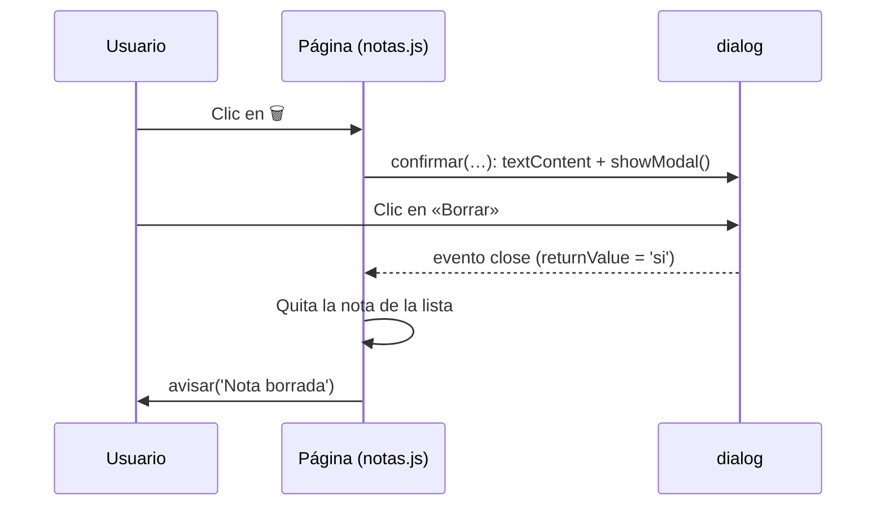

# 5. Interacción con el usuario

[⬅️ Volver a la unidad](./README.md)

## Índice

- [5.1. Formas de interactuar con el usuario](#51-formas-de-interactuar-con-el-usuario)
- [5.2. Los diálogos del navegador: `alert`, `confirm` y `prompt`](#52-los-diálogos-del-navegador-alert-confirm-y-prompt)
  - [5.2.1. Qué devuelve cada uno](#521-qué-devuelve-cada-uno)
  - [5.2.2. Sus limitaciones](#522-sus-limitaciones)
- [5.3. El elemento `<dialog>`](#53-el-elemento-dialog)
  - [5.3.1. Abrir y cerrar](#531-abrir-y-cerrar)
  - [5.3.2. Recoger la respuesta](#532-recoger-la-respuesta)
  - [5.3.3. Una función reutilizable para confirmar](#533-una-función-reutilizable-para-confirmar)
- [5.4. Mensajes que no interrumpen](#54-mensajes-que-no-interrumpen)
- [5.5. Portapapeles y notificaciones](#55-portapapeles-y-notificaciones)
- [5.6. Ejemplo integrador: borrar con confirmación](#56-ejemplo-integrador-borrar-con-confirmación)
- [Resumen](#resumen)
- [Ejercicios de reflexión](#ejercicios-de-reflexión)

> **CE que trabaja este tema:** RA3 e.

---

## 5.1. Formas de interactuar con el usuario

Interactuar es **informar** al usuario y **preguntarle**. El navegador ofrece varias formas, de más a menos intrusivas:

| Forma | Bloquea la página | Se puede diseñar | Uso hoy |
|-------|:---:|:---:|---------|
| `alert`, `confirm`, `prompt` | ✅ | ❌ | Pruebas rápidas y depuración |
| `<dialog>` modal | Solo la página (no el navegador) | ✅ | Confirmaciones y formularios cortos |
| Mensajes en la página (avisos, _toasts_) | ❌ | ✅ | Informar sin interrumpir |
| Notificaciones del sistema | ❌ | Poco | Avisos cuando la página no está visible (Ampliación) |

En esta unidad no hay todavía eventos ni formularios a fondo (UD6): verás lo justo de `addEventListener` para reaccionar a un clic.

---

## 5.2. Los diálogos del navegador: `alert`, `confirm` y `prompt`

Son métodos de `window` que muestran una ventana del propio navegador.

```js
alert('Pedido enviado');                                 // informa
const borrar = confirm('¿Seguro que quieres borrar la nota?'); // pregunta sí o no
const nombre = prompt('¿Cómo te llamas?', 'Invitado');     // pide un texto
```

### 5.2.1. Qué devuelve cada uno

| Método | Muestra | Devuelve |
|--------|---------|----------|
| `alert(mensaje)` | Mensaje y botón Aceptar | `undefined` |
| `confirm(mensaje)` | Mensaje, Aceptar y Cancelar | `true` (Aceptar) o `false` (Cancelar) |
| `prompt(mensaje, valorInicial)` | Mensaje, campo de texto, Aceptar y Cancelar | El **texto** escrito (aunque sea un número), `''` si lo deja vacío o `null` si cancela |

```js
const respuesta = prompt('¿Cuántas entradas quieres?', '1');
if (respuesta === null) {
  console.log('Cancelado');
} else {
  const cantidad = Number(respuesta.trim()); // prompt devuelve SIEMPRE texto (UD2)
  console.log(Number.isInteger(cantidad) && cantidad > 0 ? `${cantidad} entradas` : 'Cantidad no válida');
}
```

### 5.2.2. Sus limitaciones

- **Bloquean**: mientras están abiertos, la página no hace nada más (ni animaciones, ni temporizadores, ni respuestas del servidor).
- **No se pueden diseñar**: su aspecto lo decide el navegador; no siguen el estilo de tu web y algunos muestran el dominio en el título.
- **Los navegadores los limitan**: si una página abre muchos, el navegador ofrece bloquearlos; en algunos contextos (marcos de otro origen) están desactivados.
- **Son difíciles de probar** con tests automáticos, porque detienen la ejecución.

> 💡 **Tip del Examinador**: "¿Qué devuelve `prompt` si el usuario pulsa Cancelar? ¿Y si escribe 5?" → `null` si cancela, y el **texto** `'5'` (no el número) si escribe 5 y acepta.

> ✅ **Buena práctica**: Usa `alert`, `confirm` y `prompt` solo para probar algo rápido. En una aplicación, usa `<dialog>` o mensajes en la propia página.

---

## 5.3. El elemento `<dialog>`

`<dialog>` es un elemento HTML que crea un cuadro de diálogo **con el diseño de tu página**. En modo **modal**, impide interactuar con el resto de la página hasta que se cierra, pero **no bloquea** el código.

### 5.3.1. Abrir y cerrar

```html
<dialog id="aviso">
  <p>Los cambios se han guardado.</p>
  <form method="dialog">
    <button>Aceptar</button>
  </form>
</dialog>
<button id="guardar">Guardar</button>
```

```js
const aviso = document.querySelector('#aviso');
document.querySelector('#guardar').addEventListener('click', () => aviso.showModal());
```

| Método o propiedad | Qué hace |
|--------------------|----------|
| `dialogo.showModal()` | Lo abre como **modal**: fondo oscurecido (`::backdrop`), foco dentro y se cierra con `Esc` |
| `dialogo.show()` | Lo abre **sin** bloquear el resto de la página |
| `dialogo.close(valor)` | Lo cierra y guarda `valor` en `returnValue` |
| `dialogo.open` | `true` si está abierto |
| `<form method="dialog">` | Al pulsar un botón del formulario, el diálogo se cierra solo |

```css
dialog::backdrop {
  background: rgb(0 0 0 / 0.5); /* oscurece la página detrás del diálogo modal */
}
```

### 5.3.2. Recoger la respuesta

Con `<form method="dialog">`, el atributo `value` del botón pulsado queda en `dialogo.returnValue`, y al cerrarse se lanza el evento `close`:

```html
<dialog id="confirmar-borrado">
  <p>¿Borrar la nota «Lista de la compra»?</p>
  <form method="dialog">
    <button value="no">Cancelar</button>
    <button value="si">Borrar</button>
  </form>
</dialog>
```

```js
const dialogo = document.querySelector('#confirmar-borrado');
dialogo.addEventListener('close', () => {
  console.log(dialogo.returnValue === 'si' ? '🗑️ Borrada' : '↩️ Cancelado');
});
dialogo.showModal();
```

Si el usuario pulsa `Esc`, el diálogo también se cierra y `returnValue` queda vacío: se trata como «Cancelar».

### 5.3.3. Una función reutilizable para confirmar

En lugar de escribir un `<dialog>` por cada pregunta, se puede tener **uno** y una función que lo reutiliza. Como el diálogo no bloquea, la respuesta llega con un **callback** (UD3):

```js
// confirmar.js
const dialogo = document.querySelector('#confirmar');
const mensaje = dialogo.querySelector('.mensaje');

/**
 * Muestra el diálogo de confirmación y avisa de la respuesta.
 * @param {string} texto Pregunta que se muestra.
 * @param {function(boolean): void} alResponder Recibe `true` si el usuario acepta.
 */
export function confirmar(texto, alResponder) {
  mensaje.textContent = texto; // textContent: la pregunta puede llevar datos del usuario (tema 4)
  dialogo.returnValue = '';
  dialogo.addEventListener('close', () => alResponder(dialogo.returnValue === 'si'), { once: true });
  dialogo.showModal();
}
```

`{ once: true }` hace que el oyente se ejecute una sola vez y se dé de baja (como el `once` del emisor de eventos de la UD3).

> 📝 **Nota del Profesor**: En la UD7 verás cómo convertir esta función en una que devuelve una **promesa**, para escribir `if (await confirmar('¿Borrar?')) { … }` como si fuera `confirm`, pero sin bloquear.

> 💡 **Tip del Examinador**: "¿Qué ventajas tiene `<dialog>` frente a `confirm`?" → Se puede diseñar con CSS, no bloquea la ejecución del código, permite cualquier contenido (formularios, imágenes) y es accesible (gestiona el foco y la tecla `Esc`).

---

## 5.4. Mensajes que no interrumpen

Para **informar** (no preguntar), lo más respetuoso es un mensaje en la propia página que desaparece solo: un aviso o *toast*.

```html
<div id="avisos" role="status" aria-live="polite"></div>
```

```js
/**
 * Muestra un aviso que desaparece solo.
 * @param {string} texto
 * @param {number} [duracion=3000] Milisegundos que se ve.
 */
export function avisar(texto, duracion = 3000) {
  const zona = document.querySelector('#avisos');
  zona.textContent = texto;
  setTimeout(() => {
    if (zona.textContent === texto) zona.textContent = ''; // no borrar un aviso más reciente
  }, duracion);
}
```

- `role="status"` y `aria-live="polite"` hacen que los lectores de pantalla lean el aviso cuando cambia, sin interrumpir: es **accesibilidad**.
- `setTimeout` (UD3) lo borra pasado un tiempo.

---

## 5.5. Portapapeles y notificaciones

Dos APIs de `navigator` y `window` que también sirven para interactuar. Las dos piden **permiso** o una **acción del usuario**, y devuelven promesas (UD7).

```js
// Copiar un texto al portapapeles (tras un clic)
document.querySelector('#copiar').addEventListener('click', async () => {
  await navigator.clipboard.writeText('DESCUENTO20');
  avisar('✅ Código copiado');
});
```

```js
// Ampliación: notificación del sistema, con permiso del usuario
if ('Notification' in window && (await Notification.requestPermission()) === 'granted') {
  new Notification('Tu pedido ha salido del almacén');
}
```

> 📝 **Nota del Profesor**: Las notificaciones del sistema son **Ampliación**. Pide el permiso solo cuando el usuario entienda para qué (por ejemplo, al pulsar «Avisarme cuando llegue»), nunca al cargar la página: los navegadores penalizan a las webs que lo piden sin motivo.

---

## 5.6. Ejemplo integrador: borrar con confirmación

Una lista de notas en la que borrar pide confirmación con `<dialog>` y el resultado se comunica con un aviso.

```html
<!-- notas.html -->
<ul id="notas">
  <li>Comprar pan <button data-nota="Comprar pan">🗑️</button></li>
  <li>Llamar al médico <button data-nota="Llamar al médico">🗑️</button></li>
</ul>
<dialog id="confirmar">
  <p class="mensaje"></p>
  <form method="dialog">
    <button value="no">Cancelar</button>
    <button value="si">Borrar</button>
  </form>
</dialog>
<div id="avisos" role="status" aria-live="polite"></div>
```

```js
// notas.js
import { confirmar } from './confirmar.js';
import { avisar } from './avisar.js';

for (const boton of document.querySelectorAll('#notas button')) {
  boton.addEventListener('click', () => {
    const nota = boton.dataset.nota;
    confirmar(`¿Borrar la nota «${nota}»?`, (acepta) => {
      if (!acepta) {
        avisar('↩️ No se ha borrado nada');
        return;
      }
      boton.closest('li').remove(); // quita el elemento de la lista (UD5)
      avisar(`🗑️ Nota «${nota}» borrada`);
    });
  });
}
```



El diagrama muestra que el código no se queda esperando: `confirmar` abre el diálogo y termina; la respuesta llega después, por el callback.

---

## Resumen

- Interactuar es **informar** y **preguntar**, de forma más o menos intrusiva.
- `alert` informa; `confirm` devuelve `true` o `false`; `prompt` devuelve un **texto** o `null`. Los tres **bloquean** y no se pueden diseñar: solo para pruebas.
- `<dialog>` con `showModal()` crea diálogos modales con el diseño de la página, que **no bloquean** el código. `<form method="dialog">` los cierra y deja el `value` del botón en `returnValue`; el evento `close` avisa.
- Una función como `confirmar(texto, alResponder)` reutiliza un único diálogo y devuelve la respuesta por un callback.
- Para informar, mejor un aviso en la página con `role="status"` y `aria-live`.
- El portapapeles y las notificaciones necesitan una acción o un permiso del usuario.

## Ejercicios de reflexión

1. ¿Qué devuelve `prompt` en cada caso: escribe «7» y acepta; deja el campo vacío y acepta; pulsa Cancelar; pulsa `Esc`?
2. Mientras un `alert` está abierto, ¿se sigue ejecutando un `setInterval` que actualiza un reloj? ¿Y con un `<dialog>` modal? Compruébalo.
3. ¿Por qué en `confirmar` la pregunta se pone con `textContent` y no con `innerHTML`?
4. ¿Qué pasa si se suscribe el evento `close` sin `{ once: true }` y se llama a `confirmar` tres veces?
5. ¿Qué aporta `aria-live="polite"` al aviso? Busca en MDN la diferencia con `aria-live="assertive"`.

---

[⬅️ Volver a la unidad](./README.md)
