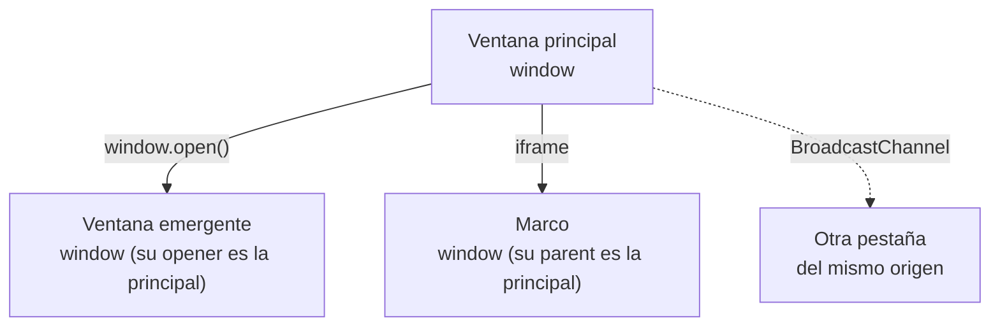
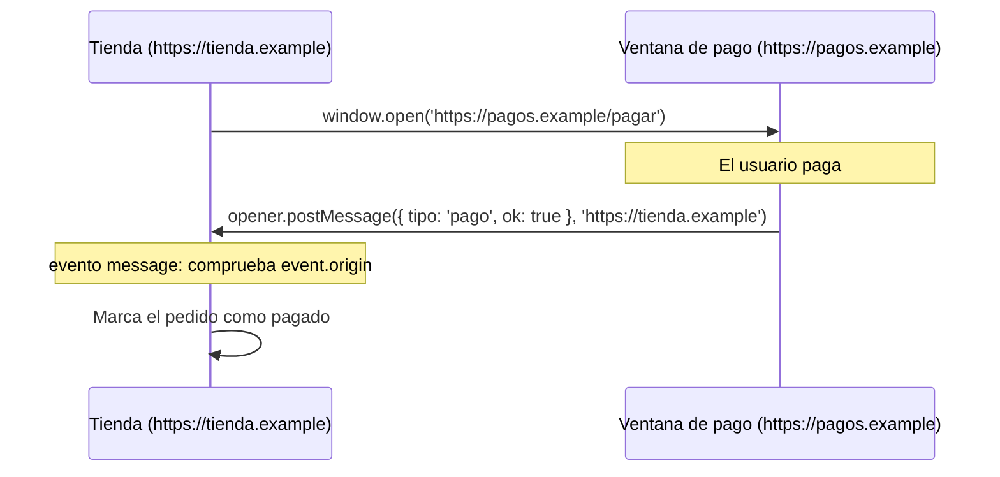

# 6. Varias ventanas

[⬅️ Volver a la unidad](./README.md)

## Índice

- [6.1. Documentos compuestos por varias ventanas](#61-documentos-compuestos-por-varias-ventanas)
- [6.2. Abrir ventanas: `window.open`](#62-abrir-ventanas-windowopen)
  - [6.2.1. La ventana que abre y la abierta: `opener`](#621-la-ventana-que-abre-y-la-abierta-opener)
  - [6.2.2. Seguridad: `noopener`](#622-seguridad-noopener)
- [6.3. Marcos: `<iframe>`](#63-marcos-iframe)
- [6.4. La política del mismo origen](#64-la-política-del-mismo-origen)
- [6.5. `postMessage`: mensajes entre ventanas](#65-postmessage-mensajes-entre-ventanas)
  - [6.5.1. Enviar](#651-enviar)
  - [6.5.2. Recibir con seguridad](#652-recibir-con-seguridad)
- [6.6. `BroadcastChannel`: mensajes entre pestañas](#66-broadcastchannel-mensajes-entre-pestañas)
- [6.7. Qué mecanismo usar](#67-qué-mecanismo-usar)
- [6.8. Ejemplo integrador: selector de color en una ventana emergente](#68-ejemplo-integrador-selector-de-color-en-una-ventana-emergente)
- [Resumen](#resumen)
- [Ejercicios de reflexión](#ejercicios-de-reflexión)

> **CE que trabaja este tema:** RA3 f.

---

## 6.1. Documentos compuestos por varias ventanas

Muchas aplicaciones web no viven en una sola ventana:

- Un **pago** se abre en una ventana del banco y, al terminar, avisa a la tienda.
- Un **mapa** o un **vídeo** de otra web se insertan con un `<iframe>`.
- Un **editor** abre una ventana de vista previa que se actualiza mientras escribes.
- La misma aplicación abierta en **dos pestañas** tiene que mantenerse sincronizada (cerrar sesión en una cierra en las dos).

Cada ventana, pestaña o marco tiene **su propio** objeto `window`, su propio `document` y sus propias variables. Este tema trata cómo se crean y cómo se comunican.



El diagrama muestra las tres relaciones del tema: ventanas abiertas con `open`, marcos dentro de la página y pestañas independientes del mismo sitio.

---

## 6.2. Abrir ventanas: `window.open`

```js
const ventana = window.open(url, nombre, caracteristicas);
```

| Parámetro | Qué es | Ejemplo |
|-----------|--------|---------|
| `url` | Página que se carga | `'ayuda.html'` |
| `nombre` | Nombre de la ventana; si ya hay una con ese nombre, se reutiliza. `'_blank'` abre siempre una nueva | `'ayuda'` |
| `caracteristicas` | Texto con opciones separadas por comas. Con `popup` o con un tamaño, se abre como ventana emergente en lugar de pestaña | `'popup,width=400,height=500'` |

```js
document.querySelector('#ayuda').addEventListener('click', () => {
  const ayuda = window.open('ayuda.html', 'ayuda', 'popup,width=400,height=500');
  if (ayuda === null) {
    console.log('❌ El navegador ha bloqueado la ventana');
  }
});
```

- `open` devuelve la **referencia** a la ventana nueva (su `window`) o `null` si el navegador la bloquea.
- Los navegadores **bloquean** las ventanas que no se abren como respuesta a una acción del usuario.
- `ventana.close()` la cierra y `ventana.closed` dice si ya está cerrada.

### 6.2.1. La ventana que abre y la abierta: `opener`

La ventana nueva conoce a la que la abrió a través de `window.opener`. Si las dos son del **mismo origen** (tema 2), pueden acceder a todo lo de la otra:

```js
// En la ventana principal
const vista = window.open('vista-previa.html', 'vista', 'popup,width=600,height=400');
// Más tarde (cuando ha cargado), acceso directo a su documento:
vista.document.body.style.fontSize = '1.25rem';
```

```js
// En vista-previa.html
console.log(window.opener.document.title); // título de la ventana principal
```

> ⚠️ **Cuidado**: El acceso directo entre ventanas solo funciona con el **mismo origen**, y crea un acoplamiento fuerte (cada ventana depende de la estructura interna de la otra). Incluso con el mismo origen, es más limpio comunicarse con mensajes (`postMessage`, apartado 6.5).

### 6.2.2. Seguridad: `noopener`

Si abres una página de **otro sitio** y esta recibe `opener`, podría redirigir tu pestaña a una página falsa (`opener.location = 'https://phishing.example'`). El ataque se llama **_tabnabbing_**. Para evitarlo:

```js
window.open('https://otra-web.example', '_blank', 'noopener,noreferrer');
```

```html
<a href="https://otra-web.example" target="_blank" rel="noopener noreferrer">Otra web</a>
```

Con `noopener`, la ventana nueva tiene `opener` a `null` y `open` devuelve `null` (ya no hay referencia). Los navegadores actuales lo aplican por defecto a los enlaces con `target="_blank"`, pero conviene escribirlo.

> 💡 **Tip del Examinador**: "¿Para qué sirve `noopener`?" → Para que la página abierta no tenga acceso a la que la abrió a través de `window.opener`, evitando que pueda redirigirla a otra página (_tabnabbing_).

---

## 6.3. Marcos: `<iframe>`

Un `<iframe>` inserta **otra página** dentro de la tuya, con su propio `window`:

```html
<iframe id="mapa" src="mapa.html" title="Mapa de la tienda" width="400" height="300"></iframe>
```

| Desde | Se accede a | Con |
|-------|-------------|-----|
| La página | El `window` del marco | `iframe.contentWindow` |
| El marco | El `window` de la página que lo contiene | `window.parent` (y `window.top`, la ventana principal) |

```html
<!-- Un marco de otro origen con el mínimo de permisos -->
<iframe src="https://widget.example" sandbox="allow-scripts" title="Widget"></iframe>
```

El atributo `sandbox` restringe lo que puede hacer el marco (enviar formularios, abrir ventanas, ejecutar código…): solo se permite lo que se indica. Es una buena práctica con contenido de terceros.

---

## 6.4. La política del mismo origen

La **política del mismo origen** (*same-origin policy*) es la regla de seguridad más importante del navegador: el código de una página solo puede **leer y modificar** el contenido de otra ventana o marco si tienen el **mismo origen** (protocolo, servidor y puerto).

| Página A | Página B | ¿Mismo origen? |
|----------|----------|:---:|
| `https://tienda.example/a.html` | `https://tienda.example/b/c.html` | ✅ |
| `https://tienda.example` | `http://tienda.example` | ❌ (protocolo) |
| `https://tienda.example` | `https://pagos.tienda.example` | ❌ (servidor) |
| `https://tienda.example` | `https://tienda.example:8443` | ❌ (puerto) |

Sin esta regla, cualquier web que visitaras podría abrir tu banco en un marco invisible y leer tus datos.

```js
const banco = document.querySelector('iframe#banco'); // de otro origen
console.log(banco.contentWindow.document); // ❌ SecurityError: acceso bloqueado
```

Entonces, ¿cómo se comunican una tienda y la ventana de pago de su banco? Con **mensajes**, que las dos partes aceptan explícitamente.

---

## 6.5. `postMessage`: mensajes entre ventanas

`postMessage` envía un **mensaje** a otra ventana (emergente, marco, `opener` o `parent`), aunque sea de **otro origen**. La otra ventana lo recibe con el evento `message` y decide si lo acepta.



El diagrama muestra el flujo: la tienda abre la ventana de pago, y esta, al terminar, envía un mensaje a su `opener` indicando a qué origen va dirigido.

### 6.5.1. Enviar

```js
otraVentana.postMessage(datos, origenDestino);
```

- `datos`: cualquier valor que pueda copiar `structuredClone` (UD3): objetos, arrays, fechas, `Map`… (no funciones).
- `origenDestino`: el origen que **debe** tener la ventana destino. Si no coincide, el mensaje no se entrega. Así no envías datos a una página que haya cambiado.

```js
// En la ventana de pago
window.opener.postMessage({ tipo: 'pago', ok: true, pedido: 42 }, 'https://tienda.example');
```

### 6.5.2. Recibir con seguridad

```js
// En la tienda
const ORIGEN_PAGOS = 'https://pagos.example';

addEventListener('message', (evento) => {
  if (evento.origin !== ORIGEN_PAGOS) return;        // 1. ¿Viene de quien espero?
  const { tipo, ok, pedido } = evento.data;          // 2. Los datos
  if (tipo !== 'pago') return;                       // 3. ¿Es el mensaje que espero?
  console.log(ok ? `✅ Pedido ${pedido} pagado` : `❌ Pago del pedido ${pedido} rechazado`);
  evento.source.postMessage({ tipo: 'recibido' }, evento.origin); // 4. Responder a quien lo envió
});
```

| Propiedad del evento | Qué contiene |
|----------------------|--------------|
| `evento.data` | Los datos enviados (una copia) |
| `evento.origin` | El origen de la ventana que lo envió |
| `evento.source` | La referencia a esa ventana, para responderle |

> ⚠️ **Cuidado**: **Comprueba siempre `evento.origin`** antes de usar un mensaje. Cualquier página que tenga una referencia a tu ventana puede enviarte mensajes. Y no uses `'*'` como origen destino al enviar datos importantes: cualquiera los recibiría.

> 💡 **Tip del Examinador**: "¿Cómo se comunican dos ventanas de distinto origen?" → Con `postMessage(datos, origenDestino)` para enviar y el evento `message` para recibir, comprobando `event.origin`. El acceso directo está bloqueado por la política del mismo origen.

---

## 6.6. `BroadcastChannel`: mensajes entre pestañas

Para comunicar **todas las pestañas y ventanas del mismo origen** que tienen abierta la aplicación, aunque no se hayan abierto unas a otras, existe `BroadcastChannel`: un canal con nombre al que se suscriben.

```js
// En cada pestaña de la aplicación
const canal = new BroadcastChannel('sesion');

canal.addEventListener('message', (evento) => {
  if (evento.data.tipo === 'cerrar-sesion') {
    location.replace('/login.html'); // las demás pestañas también cierran sesión
  }
});

document.querySelector('#salir').addEventListener('click', () => {
  canal.postMessage({ tipo: 'cerrar-sesion' }); // lo reciben todas las demás, no esta
  location.replace('/login.html');
});
```

Es el patrón **Observer** de la UD3 entre pestañas: el canal es el emisor y cada pestaña, un suscriptor.

---

## 6.7. Qué mecanismo usar

| Situación | Mecanismo |
|-----------|-----------|
| Abrir una ventana auxiliar (ayuda, vista previa, pago) | `window.open`, con `noopener` si es de otro sitio |
| Insertar otra página dentro de la tuya | `<iframe>`, con `sandbox` si es de terceros |
| Comunicar una ventana o un marco con quien lo abrió o lo contiene | `postMessage` + evento `message` comprobando `origin` |
| Sincronizar varias pestañas de tu aplicación | `BroadcastChannel` (o el evento `storage`, tema 7) |
| Acceso directo al `document` de otra ventana | Solo con el mismo origen, y mejor evitarlo |

---

## 6.8. Ejemplo integrador: selector de color en una ventana emergente

Un editor abre una ventana emergente con una paleta. Al elegir un color, la ventana se lo envía al editor con `postMessage` y se cierra. Las dos páginas se sirven desde el mismo servidor local.

```js
// editor.js (ventana principal)
const ORIGEN = location.origin; // mismo origen: el del propio editor
let paleta = null;

document.querySelector('#elegir-color').addEventListener('click', () => {
  if (paleta && !paleta.closed) {
    paleta.focus(); // ya está abierta: traerla al frente
    return;
  }
  paleta = window.open('paleta.html', 'paleta', 'popup,width=320,height=240');
  if (paleta === null) document.querySelector('#estado').textContent = '❌ Permite las ventanas emergentes';
});

addEventListener('message', (evento) => {
  if (evento.origin !== ORIGEN || evento.source !== paleta) return;
  if (evento.data?.tipo !== 'color') return;
  document.documentElement.style.setProperty('--color-destacado', evento.data.valor);
  document.querySelector('#estado').textContent = `🎨 Color elegido: ${evento.data.valor}`;
});
```

```js
// paleta.js (ventana emergente)
const COLORES = ['#e03131', '#2f9e44', '#1c7ed6', '#f08c00'];
const contenedor = document.querySelector('#colores');

contenedor.innerHTML = COLORES.map((c) => `<button data-color="${c}" style="background:${c}">${c}</button>`).join('');

contenedor.addEventListener('click', (evento) => {
  const color = evento.target.dataset.color;
  if (!color || !window.opener) return;
  window.opener.postMessage({ tipo: 'color', valor: color }, location.origin);
  window.close(); // la abrió el código, así que se puede cerrar
});
```

| Paso | Objeto o método |
|------|-----------------|
| Abrir la paleta (o traerla al frente si ya está) | `window.open`, `closed`, `focus` |
| Detectar el bloqueo de ventanas | `open` devuelve `null` |
| Enviar el color a quien abrió la ventana | `window.opener.postMessage(datos, origen)` |
| Recibir solo mensajes válidos | Evento `message`, comprobando `origin`, `source` y `data.tipo` |
| Cerrar la ventana auxiliar | `window.close()` |
| Aplicar el color | Variable CSS en el elemento raíz (tema 3) |

> 📝 **Nota del Profesor**: El `style="background:…"` en los botones de la paleta es una excepción razonable a la norma de no poner estilos en línea: el color **es el dato** que muestra cada botón y no se puede escribir de antemano en el CSS.

---

## Resumen

- Cada ventana, pestaña o marco tiene su propio `window` y su propio `document`.
- `window.open(url, nombre, caracteristicas)` abre una ventana y devuelve su referencia, o `null` si se bloquea. Solo funciona tras una acción del usuario.
- La ventana abierta conoce a la que la abrió por `opener`. Con páginas de otro sitio, usa **`noopener`** para evitar el _tabnabbing_.
- `<iframe>` inserta otra página: `contentWindow` desde fuera, `parent` y `top` desde dentro; `sandbox` limita sus permisos.
- La **política del mismo origen** impide el acceso directo entre ventanas de distinto origen (protocolo, servidor y puerto).
- **`postMessage(datos, origenDestino)`** envía mensajes entre ventanas, aunque sean de distinto origen; se reciben con el evento `message` comprobando **`origin`**.
- **`BroadcastChannel`** comunica todas las pestañas del mismo origen.

## Ejercicios de reflexión

1. ¿Tienen el mismo origen `http://localhost:5500/a.html` y `http://127.0.0.1:5500/a.html`? ¿Por qué?
2. ¿Qué ocurre si llamas a `window.open` dentro de un `setTimeout` de 5 segundos sin que el usuario haya hecho nada? Pruébalo.
3. ¿Por qué hay que comprobar `event.origin` aunque solo tu página envíe mensajes?
4. Explica con un ejemplo el ataque de _tabnabbing_ y cómo lo evita `noopener`.
5. ¿Qué mecanismo usarías para que, al añadir un producto al carrito en una pestaña, se actualice el contador en las demás pestañas de la tienda?

---

[⬅️ Volver a la unidad](./README.md)
