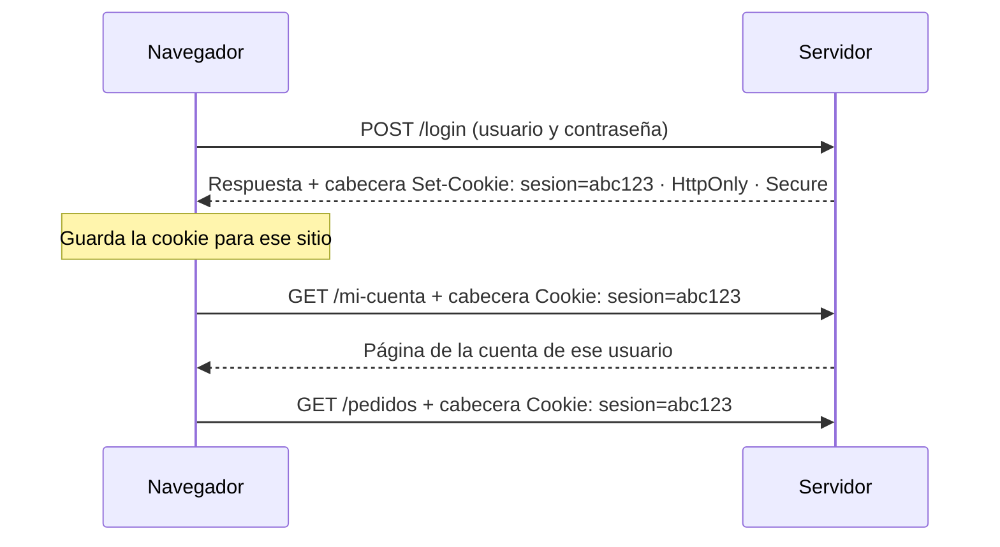
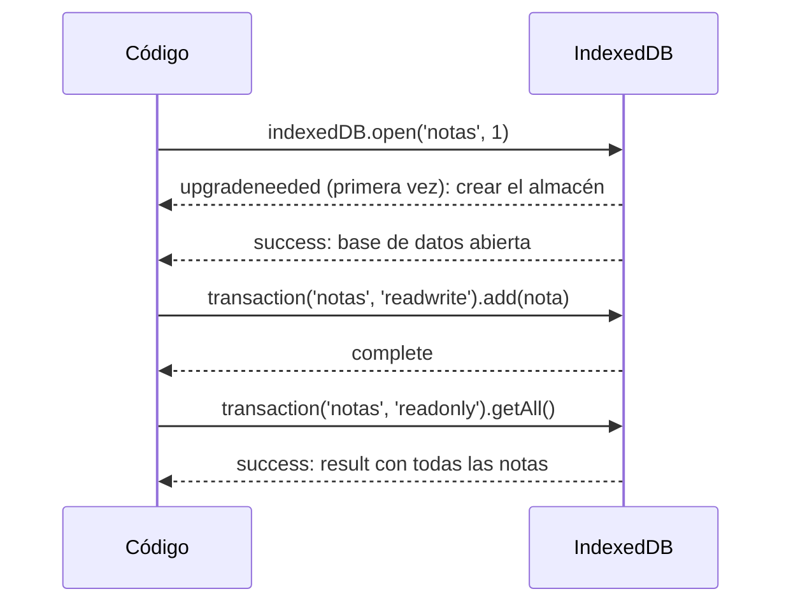
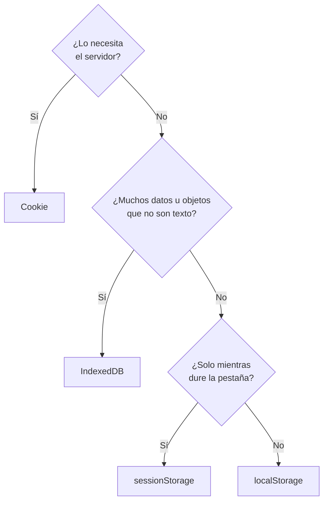

# 7. Almacenamiento en el navegador

[⬅️ Volver a la unidad](./README.md)

## Índice

- [7.1. Por qué guardar datos en el navegador](#71-por-qué-guardar-datos-en-el-navegador)
- [7.2. Cookies](#72-cookies)
  - [7.2.1. Cómo viajan las cookies](#721-cómo-viajan-las-cookies)
  - [7.2.2. Leer y escribir cookies desde JavaScript](#722-leer-y-escribir-cookies-desde-javascript)
  - [7.2.3. Atributos de una cookie](#723-atributos-de-una-cookie)
- [7.3. Web Storage: `localStorage` y `sessionStorage`](#73-web-storage-localstorage-y-sessionstorage)
  - [7.3.1. Guardar y leer](#731-guardar-y-leer)
  - [7.3.2. Guardar objetos con JSON](#732-guardar-objetos-con-json)
  - [7.3.3. El evento `storage`](#733-el-evento-storage)
- [7.4. IndexedDB](#74-indexeddb)
  - [7.4.1. Conceptos](#741-conceptos)
  - [7.4.2. Abrir la base de datos y guardar](#742-abrir-la-base-de-datos-y-guardar)
- [7.5. Cache Storage](#75-cache-storage)
- [7.6. Comparativa y cuándo usar cada uno](#76-comparativa-y-cuándo-usar-cada-uno)
- [7.7. Privacidad y RGPD](#77-privacidad-y-rgpd)
- [7.8. Ejemplo integrador: preferencias del usuario](#78-ejemplo-integrador-preferencias-del-usuario)
- [Resumen](#resumen)
- [Ejercicios de reflexión](#ejercicios-de-reflexión)

> **CE que trabaja este tema:** RA3 g.

---

## 7.1. Por qué guardar datos en el navegador

Cuando recargas una página, todas sus variables se pierden. Pero muchas cosas deberían **recordarse**: el tema elegido, el carrito, un borrador a medio escribir, la sesión iniciada… El navegador ofrece varios **mecanismos de almacenamiento** que guardan datos en el equipo del usuario, separados por **origen** (tema 2): cada sitio solo ve los suyos.

| Mecanismo | Idea en una frase |
|-----------|-------------------|
| **Cookies** | Pequeños textos que viajan al servidor en cada petición |
| **`localStorage`** | Pares clave-valor de texto que no caducan |
| **`sessionStorage`** | Igual, pero solo mientras dure la pestaña |
| **IndexedDB** | Una base de datos de objetos, para mucha información |
| **Cache Storage** | Respuestas de red guardadas para funcionar sin conexión |

> 📝 **Nota del Profesor**: Puedes ver y editar todo lo que guarda una página en la pestaña **Application** (Aplicación) de las DevTools de Chrome o **Storage** (Almacenamiento) de Firefox. Lo usarás en el tema 8 para depurar.

---

## 7.2. Cookies

Una **cookie** es un texto pequeño (unos 4 KB como máximo) con un nombre y un valor que el navegador guarda para un sitio y **envía automáticamente al servidor en cada petición** a ese sitio. Se inventaron para que el servidor "recordara" al usuario entre páginas: la sesión iniciada, el idioma, el carrito.

### 7.2.1. Cómo viajan las cookies



El diagrama muestra que la cookie la crea normalmente el **servidor** y el navegador la devuelve sola en cada petición. Por eso las cookies sirven para la **sesión**, pero no para guardar muchos datos: viajarían en todas las peticiones.

### 7.2.2. Leer y escribir cookies desde JavaScript

Desde JavaScript, las cookies se manejan con `document.cookie`, una propiedad con un comportamiento peculiar:

```js
// Escribir: cada asignación crea o actualiza UNA cookie (no borra las demás)
document.cookie = 'idioma=es; max-age=31536000; path=/; SameSite=Lax';
document.cookie = `nombre=${encodeURIComponent('Ana García')}; max-age=86400; path=/`;

// Leer: devuelve TODAS las cookies visibles en un solo texto
console.log(document.cookie); // 'idioma=es; nombre=Ana%20Garc%C3%ADa'

// Borrar: se vuelve a escribir con caducidad inmediata
document.cookie = 'nombre=; max-age=0; path=/';
```

Como la lectura devuelve un único texto, hace falta una función para sacar una cookie concreta:

```js
/**
 * Devuelve el valor de una cookie, o null si no existe.
 * @param {string} nombre
 * @param {string} [texto=document.cookie] Texto de las cookies (se puede pasar otro para probar la función).
 * @returns {string|null}
 */
export function leerCookie(nombre, texto = document.cookie) {
  const par = texto
    .split('; ')
    .map((trozo) => trozo.split('='))
    .find(([clave]) => clave === nombre);
  return par ? decodeURIComponent(par.slice(1).join('=')) : null;
}

console.log(leerCookie('nombre', 'idioma=es; nombre=Ana%20Garc%C3%ADa')); // 'Ana García'
```

### 7.2.3. Atributos de una cookie

| Atributo | Qué hace |
|----------|----------|
| `max-age=segundos` o `expires=fecha` | Cuándo caduca. Sin ninguno, es una **cookie de sesión**: se borra al cerrar el navegador |
| `path=/` | En qué rutas del sitio se envía |
| `Secure` | Solo se envía por HTTPS |
| `SameSite=Lax` / `Strict` / `None` | Si se envía en peticiones que vienen de otros sitios (protege frente a ataques CSRF) |
| `HttpOnly` | JavaScript **no** puede leerla (solo el servidor puede ponerla). Protege la sesión frente a ataques XSS (tema 4) |

> ⚠️ **Cuidado**: Nunca guardes en una cookie accesible desde JavaScript (ni en `localStorage`) datos sensibles como contraseñas o el número de una tarjeta. Las cookies de sesión las crea el servidor con `HttpOnly` y `Secure`.

---

## 7.3. Web Storage: `localStorage` y `sessionStorage`

**Web Storage** es la forma sencilla de guardar datos que solo necesita el navegador (no el servidor). Tiene dos objetos con los mismos métodos:

| | `localStorage` | `sessionStorage` |
|---|---|---|
| Duración | **Permanente**: hasta que se borre (por el código o el usuario) | Mientras dure la **pestaña** (sobrevive a recargar, no a cerrarla) |
| Compartido entre pestañas del mismo origen | ✅ | ❌ (cada pestaña tiene el suyo) |
| Uso típico | Preferencias, carrito, borradores | Datos de un proceso en curso (pasos de un formulario) |

### 7.3.1. Guardar y leer

| Método | Qué hace |
|--------|----------|
| `setItem(clave, valor)` | Guarda (el valor se convierte en **texto**) |
| `getItem(clave)` | Lee el texto, o `null` si no existe |
| `removeItem(clave)` | Borra una clave |
| `clear()` | Borra todo lo del origen |
| `key(i)`, `length` | Recorrer las claves |

```js
localStorage.setItem('tema', 'oscuro');
console.log(localStorage.getItem('tema'));   // 'oscuro'
console.log(localStorage.getItem('idioma')); // null: no existe

localStorage.setItem('visitas', 3);
console.log(typeof localStorage.getItem('visitas')); // 'string': siempre texto

const visitas = Number(localStorage.getItem('visitas') ?? 0) + 1;
localStorage.setItem('visitas', visitas);
```

### 7.3.2. Guardar objetos con JSON

Como solo guarda texto, los objetos y arrays se guardan con `JSON.stringify` y se leen con `JSON.parse` (tema 1):

```js
const carrito = [{ producto: 'Libro', unidades: 2 }];
localStorage.setItem('carrito', JSON.stringify(carrito));

const guardado = JSON.parse(localStorage.getItem('carrito') ?? '[]');
console.log(guardado[0].producto); // 'Libro'
```

> ⚠️ **Cuidado**: `localStorage.setItem('carrito', carrito)` (sin `JSON.stringify`) guarda el texto `'[object Object]'`, y los datos se pierden sin ningún error. Y al leer, el valor puede no existir o estar corrupto (lo editó el usuario, cambió el formato de tu aplicación): envuelve `JSON.parse` en `try…catch` y ten un valor por defecto.

> ⚠️ **Cuidado**: Web Storage tiene un límite de unos **5 MB por origen**. Si se supera, `setItem` lanza un error (`QuotaExceededError`). En algunos modos de navegación privada también puede fallar: trata los errores al guardar.

### 7.3.3. El evento `storage`

Cuando una pestaña modifica `localStorage`, las **demás** pestañas del mismo origen reciben el evento `storage`. Sirve para mantenerlas sincronizadas:

```js
addEventListener('storage', (evento) => {
  if (evento.key === 'tema') {
    document.documentElement.dataset.tema = evento.newValue; // aplicar el tema elegido en otra pestaña
  }
});
```

El evento trae `key`, `oldValue` y `newValue`. La pestaña que hizo el cambio **no** lo recibe.

> 💡 **Tip del Examinador**: "¿Qué diferencia hay entre `localStorage` y `sessionStorage`?" → `localStorage` es permanente y compartido por todas las pestañas del mismo origen; `sessionStorage` dura lo que la pestaña y cada pestaña tiene el suyo. Los dos guardan solo texto.

---

## 7.4. IndexedDB

### 7.4.1. Conceptos

**IndexedDB** es una **base de datos** dentro del navegador. Se usa cuando Web Storage se queda corto: muchos datos (cientos de megas, según el espacio libre), búsquedas por campos, o guardar objetos, fechas o ficheros sin convertirlos a texto.

| Concepto | Qué es | Parecido en SQL |
|----------|--------|-----------------|
| **Base de datos** | Tiene un nombre y una **versión** | Base de datos |
| **Almacén de objetos** (*object store*) | Colección de objetos con una clave | Tabla |
| **Clave** (`keyPath`) | Propiedad que identifica cada objeto (`id`) | Clave primaria |
| **Índice** | Permite buscar por otra propiedad | Índice |
| **Transacción** | Grupo de operaciones que se hacen todas o ninguna | Transacción |

Todas las operaciones son **asíncronas**: no devuelven el resultado, sino una **petición** (*request*) que avisa con un evento `success` o `error` cuando termina.

### 7.4.2. Abrir la base de datos y guardar

```js
// notas-db.js
const peticion = indexedDB.open('notas', 1); // nombre y versión

// Solo la primera vez (o al subir la versión): crear la estructura
peticion.addEventListener('upgradeneeded', () => {
  const db = peticion.result;
  db.createObjectStore('notas', { keyPath: 'id', autoIncrement: true });
});

peticion.addEventListener('success', () => {
  const db = peticion.result;

  // Guardar: una transacción de escritura sobre el almacén
  const transaccion = db.transaction('notas', 'readwrite');
  transaccion.objectStore('notas').add({ texto: 'Comprar pan', creada: new Date() });

  transaccion.addEventListener('complete', () => {
    // Leer todas: otra transacción, de solo lectura
    const lectura = db.transaction('notas', 'readonly').objectStore('notas').getAll();
    lectura.addEventListener('success', () => {
      console.log(lectura.result); // [ { texto: 'Comprar pan', creada: Date, id: 1 } ]
    });
  });
});

peticion.addEventListener('error', () => console.log('❌ No se pudo abrir la base de datos'));
```



El diagrama resume el ciclo: abrir (y crear la estructura si es nueva), escribir en una transacción y leer en otra. Cada paso avisa con un evento.

> 📝 **Nota del Profesor**: La API de IndexedDB, con tantos eventos, es incómoda. En la práctica se envuelve en funciones propias o se usa una pequeña librería (como `idb`), que la convierte en **promesas** (UD7). Aquí la ves tal cual para entender cómo funciona; en el ejercicio de las notas la envolverás en un módulo.

---

## 7.5. Cache Storage

**Cache Storage** guarda **respuestas de red** completas (páginas, imágenes, respuestas de una API) para poder mostrarlas **sin conexión**. Lo usan sobre todo los *service workers* de las aplicaciones web progresivas (PWA).

```js
// Ampliación: guardar y leer una respuesta
const cache = await caches.open('v1');
await cache.add('/estilos.css');
const respuesta = await cache.match('/estilos.css');
```

> 📝 **Nota del Profesor**: **Ampliación**. Es la base del funcionamiento sin conexión de las PWA, que van más allá de este módulo. Basta con saber que existe y para qué sirve.

---

## 7.6. Comparativa y cuándo usar cada uno

| | Cookies | `localStorage` | `sessionStorage` | IndexedDB | Cache Storage |
|---|---|---|---|---|---|
| Capacidad | ~4 KB por cookie | ~5 MB | ~5 MB | Cientos de MB (según el disco) | Cientos de MB |
| Duración | Hasta `max-age`/`expires` o fin de sesión | Permanente | La pestaña | Permanente | Permanente |
| Tipo de datos | Texto | Texto | Texto | Objetos, fechas, ficheros | Respuestas HTTP |
| Se envía al servidor | ✅ En cada petición | ❌ | ❌ | ❌ | ❌ |
| API | `document.cookie` (incómoda) | Síncrona y sencilla | Síncrona y sencilla | Asíncrona (eventos) | Asíncrona (promesas) |
| Compartido entre pestañas | ✅ | ✅ | ❌ | ✅ | ✅ |
| Uso típico | Sesión, preferencias que necesita el servidor | Preferencias, carrito, borradores | Proceso en curso en una pestaña | Muchos datos, uso sin conexión | Funcionar sin conexión (PWA) |



El diagrama es una guía rápida para elegir: primero, si el servidor necesita el dato; después, cuánto y de qué tipo; por último, cuánto tiempo.

> 💡 **Tip del Examinador**: "¿Dónde guardarías el tema elegido por el usuario? ¿Y su sesión? ¿Y 2.000 fotos para usar sin conexión?" → El tema, en `localStorage`; la sesión, en una cookie `HttpOnly` que pone el servidor; las fotos, en IndexedDB (o Cache Storage).

---

## 7.7. Privacidad y RGPD

Guardar datos en el equipo del usuario tiene implicaciones legales:

- El **RGPD** (Reglamento General de Protección de Datos de la UE) protege los **datos personales**: si guardas datos que identifican a una persona, necesitas una base legal y tienes que informar.
- En España, la **LSSI** (artículo 22.2) y la guía de cookies de la **AEPD** (Agencia Española de Protección de Datos) exigen el **consentimiento** del usuario antes de guardar cookies (o datos equivalentes en `localStorage`) que **no sean técnicas o estrictamente necesarias**: de análisis, publicidad o personalización no pedida.
- Las **técnicas** (la sesión, el carrito, recordar que el usuario rechazó las cookies) no necesitan consentimiento, pero sí informar en la política de cookies.

| Tipo | Ejemplos | ¿Consentimiento previo? |
|------|----------|:---:|
| Técnicas o necesarias | Sesión, carrito, idioma elegido, preferencia de cookies | ❌ (sí informar) |
| De análisis | Estadísticas de visitas | ✅ |
| Publicitarias | Seguimiento entre sitios | ✅ |

El aviso de cookies tiene que permitir **aceptar y rechazar con la misma facilidad**, y no se puede guardar nada no técnico hasta que el usuario acepte.

> 📝 **Nota del Profesor**: Esto no es asesoramiento legal: el centro o la empresa tendrán su propia política. Lo que sí debes saber como programador es distinguir los tipos de almacenamiento, no guardar nada no necesario sin consentimiento y que la elección del usuario se respete. Lo practicarás en el ejercicio del aviso de cookies.

---

## 7.8. Ejemplo integrador: preferencias del usuario

Un módulo de preferencias que combina `localStorage` (permanente), `sessionStorage` (la pestaña) y una cookie (que el servidor necesita para el idioma), con lectura segura.

```js
// preferencias.js
const CLAVE = 'preferencias';
const POR_DEFECTO = Object.freeze({ tema: 'claro', tamano: 1, avisos: true });

/**
 * Lee las preferencias guardadas, completando con los valores por defecto.
 * @param {Storage} [almacen=localStorage] Almacenamiento (se puede sustituir en los tests).
 * @returns {{ tema: string, tamano: number, avisos: boolean }}
 */
export function leerPreferencias(almacen = localStorage) {
  try {
    const guardadas = JSON.parse(almacen.getItem(CLAVE) ?? '{}');
    return { ...POR_DEFECTO, ...guardadas }; // lo guardado sustituye a lo de por defecto
  } catch {
    return { ...POR_DEFECTO }; // texto corrupto: se ignora
  }
}

/**
 * Guarda los cambios de preferencias.
 * @param {object} cambios Propiedades que cambian.
 * @param {Storage} [almacen=localStorage]
 * @returns {boolean} `false` si no se ha podido guardar (espacio lleno, modo privado…).
 */
export function guardarPreferencias(cambios, almacen = localStorage) {
  try {
    almacen.setItem(CLAVE, JSON.stringify({ ...leerPreferencias(almacen), ...cambios }));
    return true;
  } catch {
    return false;
  }
}

/** El idioma lo necesita el servidor: va en una cookie de un año. */
export function guardarIdioma(idioma) {
  document.cookie = `idioma=${encodeURIComponent(idioma)}; max-age=${365 * 24 * 60 * 60}; path=/; SameSite=Lax`;
}

/** Paso actual de un asistente: solo para esta pestaña. */
export function recordarPaso(paso) {
  sessionStorage.setItem('paso', String(paso));
}
```

```js
// main.js
import { leerPreferencias, guardarPreferencias, guardarIdioma } from './preferencias.js';

const preferencias = leerPreferencias();
document.documentElement.dataset.tema = preferencias.tema;
document.documentElement.style.setProperty('--tamano-letra', `${preferencias.tamano}rem`);

document.querySelector('#oscuro').addEventListener('click', () => {
  document.documentElement.dataset.tema = 'oscuro';
  if (!guardarPreferencias({ tema: 'oscuro' })) console.log('⚠️ No se ha podido recordar el tema');
});
guardarIdioma(navigator.language.slice(0, 2)); // 'es'
```

| Dato | Dónde | Por qué |
|------|-------|---------|
| Tema, tamaño, avisos | `localStorage`, como JSON | Permanente, solo lo usa el navegador |
| Paso de un asistente | `sessionStorage` | Solo tiene sentido en esa pestaña |
| Idioma | Cookie con `max-age` y `SameSite` | El servidor lo necesita para elegir el idioma de la página |

El parámetro `almacen` con valor por defecto `localStorage` permite **probar** el módulo en Node.js pasándole un almacenamiento falso: lo verás en el tema 8.

---

## Resumen

- El navegador guarda datos **por origen**: cada sitio solo ve los suyos.
- Las **cookies** son textos pequeños que viajan al servidor en cada petición; se manejan con `document.cookie` y tienen atributos de caducidad, ruta y seguridad (`Secure`, `SameSite`, `HttpOnly`).
- **`localStorage`** (permanente, compartido entre pestañas) y **`sessionStorage`** (la pestaña) guardan **texto**: los objetos, con `JSON`. Lee con `try…catch` y valores por defecto. El evento `storage` sincroniza pestañas.
- **IndexedDB** es una base de datos asíncrona de objetos: base de datos con versión, almacenes, transacciones y peticiones con eventos.
- **Cache Storage** guarda respuestas de red para funcionar sin conexión (Ampliación).
- Elige según si lo necesita el servidor, cuántos datos son y cuánto deben durar.
- Las cookies y datos **no técnicos** necesitan el **consentimiento** previo del usuario (RGPD, LSSI y guía de la AEPD).

## Ejercicios de reflexión

1. Abre una web que uses a diario y revisa en la pestaña Application qué cookies y qué datos de `localStorage` guarda. ¿Para qué crees que sirve cada uno?
2. ¿Qué se guarda con `localStorage.setItem('datos', { a: 1 })`? ¿Cómo lo harías bien?
3. ¿Por qué la cookie de sesión debe tener `HttpOnly`? Relaciónalo con los ataques XSS del tema 4.
4. Abre la misma página en dos pestañas, cambia un valor de `sessionStorage` en una y comprueba la otra. Repite con `localStorage`. ¿Qué observas?
5. ¿Necesita consentimiento una cookie que recuerda que el usuario ha **rechazado** las cookies? Justifícalo.

---

[⬅️ Volver a la unidad](./README.md)
