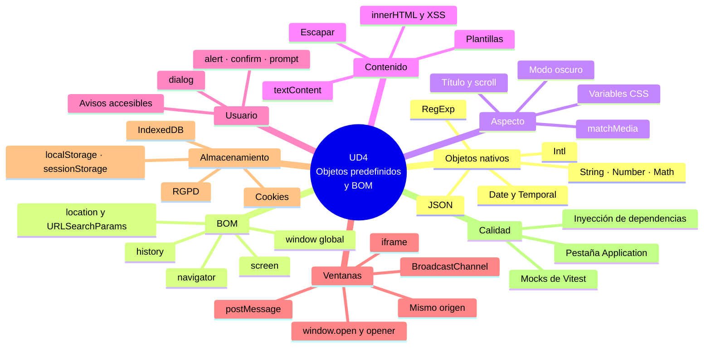

# 9. Resumen y mapa mental

[⬅️ Volver a la unidad](./README.md)

- [9. Resumen y mapa mental](#9-resumen-y-mapa-mental)
  - [Resumen ejecutivo](#resumen-ejecutivo)
  - [Mapa mental](#mapa-mental)
  - [Checklist de evaluación](#checklist-de-evaluación)
    - [Objetos nativos (CE a)](#objetos-nativos-ce-a)
    - [Ventanas y documentos: el BOM (CE b)](#ventanas-y-documentos-el-bom-ce-b)
    - [Aspecto del navegador y del documento (CE c)](#aspecto-del-navegador-y-del-documento-ce-c)
    - [Generar textos y etiquetas (CE d)](#generar-textos-y-etiquetas-ce-d)
    - [Interacción con el usuario (CE e)](#interacción-con-el-usuario-ce-e)
    - [Varias ventanas (CE f)](#varias-ventanas-ce-f)
    - [Almacenamiento (CE g)](#almacenamiento-ce-g)
    - [Depuración y documentación (CE h)](#depuración-y-documentación-ce-h)

## Resumen ejecutivo

En esta unidad has aprendido a usar los **objetos que ya trae el lenguaje** y los que aporta el **navegador**:

1. **Objetos nativos**: `String`, `Number`, `Math`, `Date`, `JSON`, `Intl` y una primera mirada a `RegExp`. Objetos envoltorio. Fechas con meses desde 0 y `Temporal` como Ampliación. `Intl` para mostrar números, monedas y fechas en español.
2. **El BOM**: `window` como objeto global, `location` y `URLSearchParams`, `history`, `navigator` con detección de capacidades y `screen`. BOM frente a DOM.
3. **La apariencia de la ventana**: tamaño, desplazamiento, título, tema con clases, atributos y variables CSS, `matchMedia`, modo oscuro, pantalla completa e impresión.
4. **Generar contenido**: por qué no `document.write`, `textContent` frente a `innerHTML`, ataques XSS y cómo escapar, HTML generado con plantillas y textos con `Intl`.
5. **Interacción con el usuario**: `alert`, `confirm` y `prompt` y sus límites, `<dialog>`, avisos accesibles, portapapeles y notificaciones.
6. **Varias ventanas**: `window.open`, `opener` y `noopener`, `<iframe>`, la política del mismo origen, `postMessage` y `BroadcastChannel`.
7. **Almacenamiento**: cookies, `localStorage`, `sessionStorage`, IndexedDB y Cache Storage, cuándo usar cada uno, y privacidad (RGPD, LSSI, AEPD).
8. **Depuración, documentación y pruebas**: la pestaña Application, documentar módulos que usan el navegador, inyección de dependencias, dobles de prueba y mocks de Vitest.

## Mapa mental

## Checklist de evaluación

### Objetos nativos (CE a)

- [ ] Distingo los objetos nativos del lenguaje de los que aporta el navegador o Node.js
- [ ] Sé qué son los objetos envoltorio y por qué no se usa `new String`
- [ ] Uso los métodos de `String`, `Number` y `Math`, y sé que `toFixed` devuelve texto
- [ ] Creo, leo y modifico fechas con `Date` sabiendo que los meses empiezan en 0 y que es mutable
- [ ] Convierto datos a texto y al revés con `JSON` y sé qué se pierde
- [ ] Muestro números, monedas, fechas y listas con `Intl`

### Ventanas y documentos: el BOM (CE b)

- [ ] Explico qué es el BOM y en qué se diferencia del DOM
- [ ] Sé que `window` es el objeto global en el navegador
- [ ] Leo las partes de la URL con `location` y los parámetros con `URLSearchParams`
- [ ] Navego con `location` y `history`, y sé para qué sirve `pushState`
- [ ] Uso `navigator` para detectar capacidades, no navegadores
- [ ] Distingo el tamaño de la pantalla (`screen`) del de la ventana

### Aspecto del navegador y del documento (CE c)

- [ ] Cambio el título de la pestaña y desplazo la página
- [ ] Cambio el aspecto con clases, atributos `data-*` y variables CSS, sin estilos sueltos
- [ ] Uso `matchMedia` y su evento `change`
- [ ] Programo un modo oscuro que respeta la preferencia del sistema y la elección del usuario
- [ ] Sé qué cambios de la ventana ya no permite el navegador y por qué

### Generar textos y etiquetas (CE d)

- [ ] Sé por qué no se usa `document.write`
- [ ] Uso `textContent` para texto e `innerHTML` para estructuras
- [ ] Explico qué es un ataque XSS y escapo los datos externos
- [ ] Genero HTML a partir de arrays con plantillas, `map` y `join('')`
- [ ] Redacto textos legibles con `Intl` (plurales, listas, fechas relativas)

### Interacción con el usuario (CE e)

- [ ] Uso `alert`, `confirm` y `prompt` sabiendo qué devuelven y por qué no se usan en aplicaciones
- [ ] Creo diálogos con `<dialog>`, `showModal` y `<form method="dialog">`, y recojo la respuesta
- [ ] Muestro avisos que no interrumpen y son accesibles

### Varias ventanas (CE f)

- [ ] Abro ventanas con `window.open` y gestiono que el navegador las bloquee
- [ ] Explico la política del mismo origen
- [ ] Sé para qué sirven `opener`, `noopener` e `<iframe sandbox>`
- [ ] Comunico ventanas con `postMessage` comprobando `origin`
- [ ] Sincronizo pestañas con `BroadcastChannel` o el evento `storage`

### Almacenamiento (CE g)

- [ ] Leo y escribo cookies y conozco sus atributos
- [ ] Guardo y recupero datos con `localStorage` y `sessionStorage`, usando JSON y `try…catch`
- [ ] Guardo y leo objetos en IndexedDB
- [ ] Elijo el mecanismo adecuado según el caso
- [ ] Sé qué cookies y datos necesitan el consentimiento del usuario

### Depuración y documentación (CE h)

- [ ] Inspecciono, edito y borro el almacenamiento en la pestaña Application
- [ ] Documento qué objetos del navegador usa un módulo y qué datos guarda
- [ ] Inyecto dependencias para probar código que usa el navegador
- [ ] Escribo tests con dobles de prueba y con los mocks de Vitest (`setSystemTime`, `spyOn`, `stubGlobal`, `fn`)

---

[⬅️ Volver a la unidad](./README.md)
