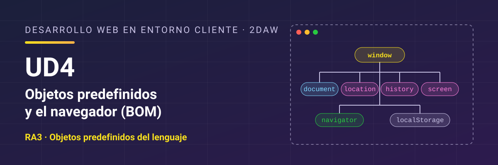

# Desarrollo Web en Entorno Cliente - UD4 Objetos predefinidos y el navegador (BOM)

Unidad 4 Objetos predefinidos y el navegador (BOM). 2DAW.

## Resultado de aprendizaje

Esta unidad trabaja el **RA3** y sus criterios de evaluación: [ver resultado de aprendizaje y criterios de evaluación](./resultados-aprendizaje.md).

## Referencias

- [*Eloquent JavaScript*](https://www.eloquentjavascript.es/), de Marijn Haverbeke (4.ª edición, traducida al español por midudev; licencia CC BY-NC). Libro gratuito en línea que explica el lenguaje y el navegador con otro enfoque y trae ejercicios. Es una buena lectura complementaria para cualquier unidad del curso. Ten en cuenta que llama **enlace** (*binding*) a lo que en el curso llamamos **variable** o **constante**, que usa comillas dobles y, a veces, `prompt`, y que la traducción tiene alguna errata. Si algo no cuadra, consulta el original en inglés en [eloquentjavascript.net](https://eloquentjavascript.net/).

## Contenidos

1. [Objetos nativos del lenguaje](./01-objetos-nativos.md)
2. [El navegador como objeto: el BOM](./02-bom.md)
3. [La apariencia de la ventana](./03-apariencia-ventana.md)
4. [Generar contenido desde el código](./04-generar-contenido.md)
5. [Interacción con el usuario](./05-interaccion-usuario.md)
6. [Varias ventanas](./06-ventanas.md)
7. [Almacenamiento en el navegador](./07-almacenamiento.md)
8. [Depuración, documentación y pruebas](./08-depuracion-documentacion.md)
9. [Resumen](./09-resumen.md)

## Licencia

Este material se distribuye bajo licencia **Creative Commons BY-NC-SA 4.0**. Consulta las condiciones en [LICENSE.md](./LICENSE.md).
